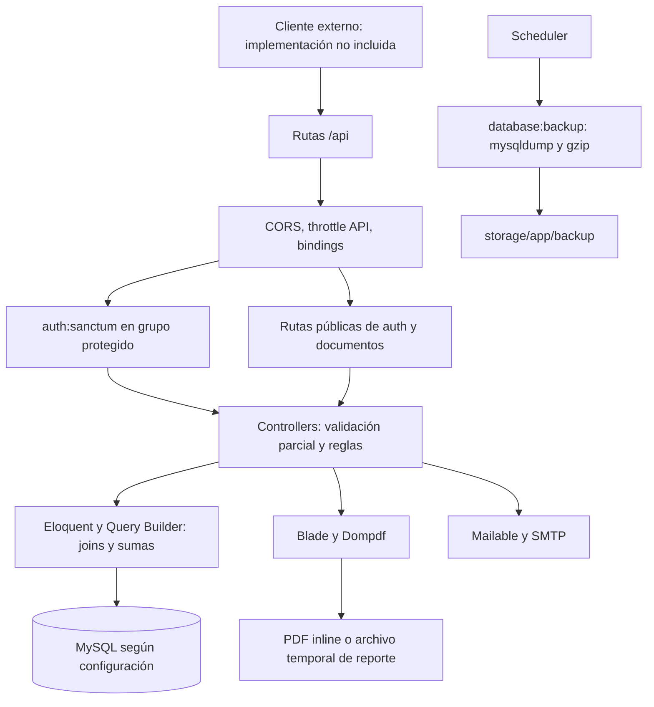
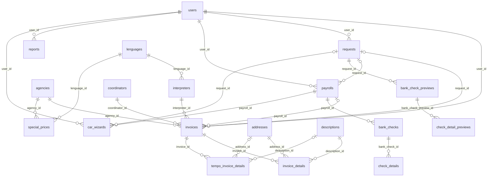
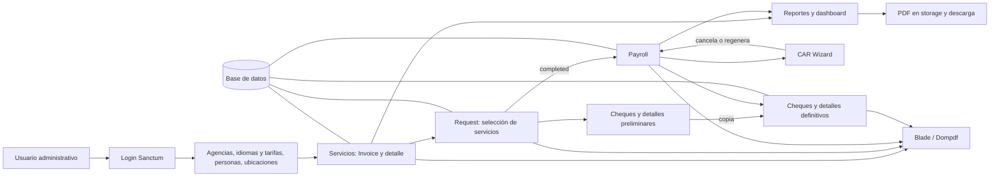

# Análisis integral de ia-system-cloud

Fecha: 13 de septiembre de 2026. Revisión estática del checkout local.

## 1. Resumen ejecutivo y alcance

El sistema administra servicios de interpretación: registra agencias, intérpretes, coordinadores, idiomas y tarifas; emite facturas; agrupa servicios en solicitudes de pago; convierte solicitudes en planillas y cheques; permite cancelar/regenerar planillas y produce reportes de pagos. Esta conclusión se apoya en `InvoiceController::store`, `RequestController::store/newStatus`, `CARWizardController::store`, sus modelos, migraciones y plantillas PDF, además del README.

Es un backend monolítico Laravel 10, orientado a API, con Eloquent y lógica concentrada en controladores. Blade se usa para documentos, correos y errores. El frontend operativo no está en este repositorio. No se identificaron capas Services/Repositories, Form Requests, API Resources, Actions, DTO, Policies ni Jobs propios.

Hay riesgos críticos de recuperación de cuentas, acceso público a documentos y ausencia de autorización por usuario. El proceso financiero tiene múltiples escrituras sin transacciones, estados sin validación suficiente y manejo de numeración de cheques mediante ALTER TABLE. Varias rutas declaradas no tienen implementación.

Se inspeccionaron los 20 archivos de controladores, 22 modelos, las 32 migraciones, seeders y factory, las cuatro fuentes de rutas, configuración, middleware, providers, frontend disponible, expresiones y estructura de las siete plantillas PDF, correo, pruebas y Docker. Los anexos ofrecen inventarios trazables.

**Límites:** no hay `vendor/`, `node_modules/`, `.env`, esquema exportado ni base de datos accesible examinada. PHP y Composer no se encontraron en PATH. No se instaló nada, no se arrancó Laravel, no se ejecutaron tests, migraciones, comandos de backup, solicitudes HTTP ni consultas a la base. Los comportamientos descritos son los que expresa el código; su reproducción y el despliegue real son **No confirmado / requiere validación**. No se realizó una auditoría de CVE ni se afirma que las dependencias estén libres de vulnerabilidades. Los riesgos no se explotaron.

La única escritura autorizada en esta fase es este documento. El árbol Git estaba limpio al comenzar.

## 2. Propósito, usuarios y contexto de negocio

El nombre de carpeta es `ia-system-cloud`; Composer conserva `laravel/laravel`; el README lo llama “Interpreters Billing System – Backend API” y el correo usa “IA System”. La identidad comercial definitiva requiere validación.

Los usuarios autenticados parecen ser operadores administrativos. Intérpretes, coordinadores y agencias son entidades distintas de `User`, sin credenciales ni vínculo de acceso propio. No hay roles ni separación de administración implementados. Los datos de estados de EE. UU., SSN, domicilios, importes y cheques apuntan a una operación estadounidense; jurisdicción, moneda oficial y validez de documentos: **No confirmado / requiere validación**.

Problema resuelto: reunir servicios prestados, importes facturados y remuneraciones por persona, preparar lotes de pago y documentación para su control. `Invoice` representa un servicio facturable y tiene detalles de fecha, horario, desplazamiento y asignación. Aunque la relación admite varios detalles, la creación produce uno y varias consultas/PDF toman solo el primero.

Flujo general confirmado: catálogos → factura y detalle → revisión/selección de servicios → solicitud con cheques preliminares → completar solicitud → planilla con cheques definitivos → documentos y reportes. CAR Wizard ofrece cancelación y regeneración posteriores.

### Diferencias con el README

| README | Evidencia real |
|---|---|
| JWT y middleware auth:api | Sanctum con tokens personales y `auth:sanctum`; sin paquete JWT/Passport |
| Spatie Permissions | Sin dependencia, tablas de roles ni políticas implementadas |
| Laravel Excel | Sin paquete Excel, exportador ni endpoint confirmado |
| Registro público, dashboard y languages | No existe `/api/register`; dashboard es `/api/reports/dashboards`; se usa `lenguages` |
| Controllers plurales, PDFController y SettingsController | No existen con esos nombres; PDFs dentro de controllers de negocio |
| Servicios con 45 días para planilla | `RequestController::review` no filtra por antigüedad ni por las fechas recibidas |
| Scheduler de planillas/notificaciones/limpieza | Únicamente `database:backup` cada hora |

## 3. Stack y dependencias

Las versiones fijadas son las de `composer.lock`, no versiones instaladas verificadas.

| Dependencia | Declarada / fijada | Uso e importancia |
|---|---|---|
| PHP | ^8.1 / runtime no confirmado | Base; `match`, tipos y NumberFormatter requieren entorno compatible; intl para cheques |
| laravel/framework | ^10.0 / v10.4.1 | Framework, HTTP, ORM, correo, consola; esencial |
| laravel/sanctum | ^3.2 / v3.2.1 | Tokens personales; esencial |
| barryvdh/laravel-dompdf | ^2.0 / v2.0.1 | Integración de PDF; esencial |
| dompdf/dompdf | transitiva / v2.0.3 | Motor PDF |
| guzzlehttp/guzzle | ^7.2 / 7.5.0 | Cliente HTTP declarado; sin uso directo de negocio localizado |
| laravel/tinker | ^2.8 / v2.8.1 | Consola interactiva; sin uso desde procesos de negocio |
| fakerphp/faker | ^1.9.1 / v1.21.0 | Desarrollo; factory presente pero datos principales fijos |
| laravel/pint | ^1.0 / v1.7.0 | Formato de código; sin pipeline confirmado |
| laravel/sail | ^1.18 / v1.21.2 | Entorno de desarrollo Docker |
| mockery/mockery | ^1.4.4 / 1.5.1 | Pruebas; sin mocks de negocio |
| nunomaduro/collision | ^7.0 / v7.3.1 | Errores en CLI |
| phpunit/phpunit | ^10.0 / 10.0.17 | Dos tests de ejemplo |
| spatie/laravel-ignition | ^2.0 / 2.0.0 | Diagnóstico en desarrollo; no es Spatie Permissions |
| axios | ^1.1.2 / no fijada | Bootstrap de JS; sin llamadas funcionales locales |
| laravel-vite-plugin | ^0.7.2 / no fijada | Integración de assets |
| vite | ^4.0.0 / no fijada | Scripts npm dev/build |

Composer se usa mediante PSR-4, lock y scripts de descubrimiento/publicación; su binario no tiene versión fijada. NPM no dispone de lock en el checkout. Docker instala Composer con su instalador y herramientas Node sin fijar todas las versiones efectivas.

MySQL es el driver predeterminado; utf8mb4 y modo estricto. Hay configuraciones estándar SQLite/PostgreSQL/SQL Server, pero SQL como `ALTER TABLE ... AUTO_INCREMENT` y `mysqldump` introduce dependencia efectiva de MySQL. Blade/CSS tradicional; no React, Vue, Livewire ni framework visual de aplicación confirmado. Las vistas vendor de paginación incluyen Bootstrap/Tailwind, lo que no demuestra su uso por una interfaz operativa.

Correo síncrono SMTP por defecto; colas `sync`; caché y sesiones en archivos; filesystem local; Monolog mediante stack/single. Zona horaria Laravel `America/New_York`, locale `en`; Docker UTC. Evidencia: `config/{app,database,mail,queue,cache,session,logging,filesystems}.php`.

## 4. Arquitectura



`public/index.php` y `bootstrap/app.php` arrancan el kernel HTTP; `RouteServiceProvider` registra prefijo `/api` y web. El controller base incorpora traits de autorización/validación, pero no basta para aplicar permisos: las acciones de negocio no invocan `authorize` ni gates.

Inyección principalmente por parámetros de acción (`Illuminate\Http\Request` y modelos enlazados a rutas); no servicios de negocio inyectados por constructor. Controllers usan fachadas estáticas, modelos y helpers. Modelos contienen principalmente atributos y relaciones, sin cálculos de negocio. Consultas manuales incluyen `selectRaw`, `DB::raw` para CONCAT, DDL en wizard y TRUNCATE en una migración; no procedimientos almacenados encontrados.

## 5. Estructura del proyecto

| Área | Contenido y papel |
|---|---|
| app/Http/Controllers | 20 archivos, incluido Controller base; procesos, consultas, respuestas y PDFs |
| app/Models | 22 modelos; inventario en sección 10/anexo |
| app/Http/Middleware | Middleware estándar de auth, CSRF, cookies, proxy y saneamiento |
| app/Providers | Registro de rutas, auth vacío, evento Registered; BroadcastServiceProvider propio no activado en config/app |
| app/Console | Kernel y único comando de backup |
| app/Mail | ForgotPasswordMailable |
| app/Exceptions | Handler sin personalización de respuesta |
| bootstrap | Arranque clásico de Laravel 10 y directorio cache |
| config | Configuración Laravel, Dompdf, Flare/Ignition y URL de frontend |
| database | Migraciones versionadas, dos seeders, una factory de User |
| routes | api.php, web.php, console.php, channels.php |
| resources | Siete PDFs, email, errores, vistas vendor, welcome, dos JS y CSS vacío |
| public | Front controller, .htaccess, robots, favicon, imagen de banco; sin build de frontend |
| storage | Estructura de cache/sesión/vistas/logs y fuentes Calibri/MICR con metadatos generados |
| tests | Un test unitario trivial y uno HTTP de raíz; soporte de arranque |
| docker | Variantes 7.4, 8.0, 8.1, 8.2 y scripts de desarrollo |

No existen directorios propios Services, Repositories, Http/Requests, Http/Resources, Jobs, Notifications, Policies, Actions o DTO. `App\Models\Request` es la solicitud de pago, no un Form Request.

## 6. Módulos funcionales

Los endpoints exactos y su implementación se enumeran en el anexo A. En todos los módulos la capa de servicio es el propio controller; no hay pantalla funcional local que permita confirmar formularios o validación cliente. Las vistas indicadas son exclusivamente documentos.

### 6.1 Autenticación y usuarios

- Propósito: acceso y gestión de cuentas administrativas.
- Rutas/controllers: `/api/login`, recuperación/validación y logout → AuthController; `/api/users*` → UserController.
- Modelos/tablas: User/users, PersonalAccessToken/personal_access_tokens, PasswordReset/password_reset_tokens.
- Frontend/vistas: correo `emails.forgot-password`; enlace externo configurable.
- Flujo y reglas: credenciales → token Sanctum; creación de usuario con email único y password bcrypt. Login no verifica `status`. UpdatePassword verifica contraseña actual solo si se envía.
- Dependencias: User referencia facturas, solicitudes, planillas, reportes y wizard.
- Riesgos: recuperación expone token, modificación de otras cuentas, borrado con cascadas, respuesta `role_id` sin columna/rol confirmado.

### 6.2 Agencias

- Propósito: clientes destinatarios de facturas; rutas `/api/agencies*`, AgencyController, Agency/agencies.
- Flujo: alta con campos requeridos → create; lista completa/activos; búsqueda por nombre activo; actualización masiva. Show/destroy vacíos.
- Reglas: email/teléfono únicos en BD, sin validación equivalente completa en controller.
- Relaciones: facturas y precios especiales por idioma. Sin vistas propias. Riesgos de cambios arbitrarios de columnas y respuestas con modelo desactualizado.

### 6.3 Idiomas y tarifas especiales

- Rutas `/api/lenguages*`; LenguageController, Lenguage/lenguages y SpecialPrice/special_prices.
- Propósito: tarifa por hora de venta e intérprete, más excepciones por agencia.
- Flujo: alta idioma; consulta activos con tarifas; attach/updateExistingPivot/detach para excepciones.
- Reglas: par idioma/agencia único en BD; comprobación previa de duplicado en storeSpecialPrice; reglas `required`, sin validación numérica/existencia completa.
- Dependencias: intérpretes, agencias, PDF factura. Sin servicio ni vista propios. `showSpecialPriceByAgency` consulta relación `agencies` inexistente; la real es `agenciesWithSpecialPrices`. El cálculo de factura no aplica tarifas especiales en backend.

### 6.4 Intérpretes

- `/api/interpreters*`, InterpreterController, Interpreter/interpreters.
- Propósito: prestadores de servicios; idioma, contacto, SSN y domicilio.
- Alta explícita o desde factura; consulta con idioma; filtro por estado geográfico, idioma, nombre y activo; update masivo; show/destroy vacíos.
- Relaciones: idioma y facturas; consumo por solicitud, wizard y reportes, además de PDFs. No validación de alta en controller. Datos personales serializados sin ocultación específica.

### 6.5 Coordinadores

- `/api/coordinators*`, CoordinatorController, Coordinator/coordinators.
- Propósito: persona asociada al servicio y remunerada mediante `total_coordinator`.
- Lista, alta sin validación ni respuesta explícita, consulta individual, update masivo; destroy vacío y search inexistente pese a ruta.
- Relaciones con facturas; sumas por persona en cheques/reportes. Plantilla quincenal usa datos del primer coordinador aunque agrupa servicios de varios: alcance real requiere validación.

### 6.6 Descripciones y direcciones

- `/api/descriptions*`, DescriptionController, Description/descriptions: catálogo de resultado/descripción del servicio; alta de título, lista/activos, búsqueda, update; show/destroy vacíos.
- `/api/addresses*`, AddressController, Address/addresses: ubicaciones; lista y búsqueda con label concatenado; resto CRUD vacío. Factura crea o reutiliza dirección por coincidencia exacta de cinco campos.
- Ambas se relacionan con InvoiceDetail y TempoInvoiceDetail. Se usan en `pdf.invoice`, `pdf.fortnightly` y detalles de cheques. Datos duplicados posibles bajo concurrencia; sin restricción compuesta de direcciones.

### 6.7 Facturas y servicios

- `/api/invoices*`, InvoiceController; Invoice/invoices, InvoiceDetail/invoice_details; catálogos relacionados.
- Propósito: guardar servicio, importes y estado de cobro; documento `pdf.invoice`.
- Flujo: resolver/crear intérprete, dirección y descripción → crear cabecera → detalle → respuesta 201 con ID. Update repite resolución y cambia primer detalle.
- Reglas: número compuesto por assignment e iniciales del intérprete; consulta de duplicados ignora factura cancelada; guardas de cancelación si existe planilla created o solicitud pending/completed.
- Estados encontrados: pending por defecto, paid y cancelled usados por código; entrada de estado sin enumeración validada.
- Dependencias: solicitudes, planillas y reportes. Riesgos: importes y user_id del cliente, ausencia de transacción/validación, asignación sin UNIQUE, cambios de facturas vinculadas sin resincro de cheques. DELETE vacío.

### 6.8 Solicitudes de pago

- `/api/requests*`, RequestController; Request/requests, BankCheckPreview/bank_check_previews y CheckDetailPreview/check_detail_previews, facturas y planillas.
- Propósito: preparar lote de servicios y cheques antes de convertirlo en planilla. Vistas `pdf.fortnightly` con preview y `pdf.bank-checks` con preview.
- Flujo: review candidatos → store recibe services → total cabecera, asociaciones y cheques por persona → newStatus completed crea planilla y copia cheques/detalles.
- Reglas: prefijo PR-; pending inicial; completed rechaza solicitud con planilla existente; cancelled libera facturas y borra previews si no hay planilla. Otros estados se escriben sin whitelist.
- Riesgos: review no aplica fechas; store no repite restricciones de candidatos; transiciones pueden saltar estados; primera planilla asume que ya existe una; show/update/destroy vacíos.

### 6.9 Planillas y cheques

- `/api/payrolls*`, PayrollController; `/api/bank-checks*`, BankCheckController; descarga preliminar BankCheckPreviewController.
- Modelos/tablas: Payroll/payrolls, BankCheck/bank_checks, CheckDetail/check_details, Request y previews.
- Propósito: lote definitivo de remuneraciones/documentos; no nómina salarial con impuestos/deducciones confirmada.
- Flujo: creación efectiva desde RequestController o CARWizardController; index/show/wizard/lastPayroll; PDF quincenal y PDF cheques. POST/PUT payrolls vacíos; todos los CRUD BankCheck vacíos.
- Reglas: prefijo P-; created inicial, cancelled por wizard; cheque usa ID como número (migración inicia en 1700). Payroll::destroy libera payroll_id de facturas y borra planilla; cascada borra cheques, detalles y registros wizard asociados.
- Riesgos: delete puede perder evidencia financiera y deja request_id en facturas; todos los PDFs públicos; numeración técnica usada como numeración de documento.

### 6.10 CAR Wizard

- `/api/car-wizard*`, CARWizardController; CARWizard/car_wizards y entidades de pago.
- Propósito confirmado: cancelar una planilla y, para `actionRequest == 'Regenerate'`, crear otra con servicios seleccionados. Significado exacto de la sigla: **No confirmado / requiere validación**.
- Flujo: desvincular facturas → cancelar planilla/solicitud → borrar cheques/previews → ajustar AUTO_INCREMENT → regenerar opcionalmente → registrar acción/comentario/usuario.
- Sin servicios/vistas propios; usa `RequestController::getAbbrState`, NumberFormatter y tablas de cheques. Index carga usuario/planilla/solicitud; show/update/destroy vacíos.
- Riesgos: cualquier acción distinta de Regenerate igualmente ejecuta cancelación; sin validación, permiso, transacción ni locks; falla si no hay primer cheque; modifica secuencia global; log al final puede faltar si ocurre error intermedio. `WizardView` es tabla real, no vista SQL, y no participa en el flujo localizado.

### 6.11 Reportes y dashboard

- `/api/reports*`, ReportController; Report/reports es catálogo con título, descripción y filtros JSON, no historial de documentos generados.
- Cuatro generadores: mensual, anual, acumulado por año y mensual por periodo 01–15/16–fin. Dashboard suma importes sobre planillas del mes.
- Tablas: reports/users para parámetros; interpreters/coordinators, invoices/invoice_details/payrolls para agregaciones; agencies para conteo y lenguages para filtro indirecto.
- Vistas: monthly, annual, cumulative y monthly-by-payment. Archivo temporal y enlace de descarga pública.
- Reglas: solo personas activas; filtro nombre/idioma únicamente a intérpretes; tipo All/Interpreter/Coordinator. Selección del generador con match estricto de ID entero 1–4. ReportsTableSeeder define esas cuatro filas pero no se invoca desde DatabaseSeeder.
- Riesgos: nombres de archivos colisionan entre usuarios/filtros; download elimina archivo; lógica por ID frágil si se borra/recrea catálogo; consultas por persona/periodo; fechas límite y hardcode de intérprete 15 en dashboard.

### 6.12 Componentes residuales y operación

InvoiceDetailController, TempoInvoiceDetailController, CheckDetailController y CheckDetailPreviewController tienen cinco métodos CRUD vacíos cada uno y no rutas directas. Los detalles reales se crean desde controllers principales. TempoInvoiceDetail tiene modelo/tabla/relaciones pero no flujo activo confirmado. Backup constituye el único proceso programado propio.

## 7. Rutas y superficie HTTP

`routes/api.php` declara las rutas de negocio bajo prefijo `/api`. El grupo `api` aplica throttle y bindings; `auth:sanctum` protege el grupo principal. El limitador es 60 peticiones/minuto por usuario identificado o IP (`RouteServiceProvider::configureRateLimiting`), sin limitadores específicos de login/reset.

Fuera del grupo autenticado quedan cinco endpoints de autenticación, seis descargas y last-payroll. No hay middleware administrativo, de ownership, abilities o firma en esas declaraciones. Los parámetros tipados con nombre coincidente permiten binding y 404 si no existe el modelo; binding no implica autorización.

`routes/web.php`: GET `/` público, middleware web, closure devuelve `welcome`, cuyo contenido es `<h1>404</h1>` pero no establece HTTP 404; la respuesta normal es 200. No hay rutas web de login con nombre `login`. `Authenticate::redirectTo` intenta esa ruta si el cliente no espera JSON: posible error de redirección en vez de 401.

`routes/console.php`: comando inspire, sin HTTP. `routes/channels.php`: canal App.Models.User.{id}, autoriza igualdad de usuario e ID; provider propio de broadcasting no activado en config/app, sin flujo realtime confirmado. Rutas de paquetes como csrf-cookie dependen del arranque de dependencias; no se incluyen como declaraciones propias verificadas.

El **anexo A** enumera cada declaración HTTP de api.php con verbo, parámetros, controller, acción, middleware y estado. No se ejecutó route:list para evitar arrancar la aplicación.

## 8. Autenticación, sesiones y autorización

```text
POST /api/login
 → valida email/password → Auth::attempt con provider User
 → si encuentra token previo: elimina el primero y responde 401
 → de lo contrario createToken(id)->plainTextToken → JSON token/id
 → cliente envía Bearer → auth:sanctum → acción protegida
POST /api/logout → elimina TODOS los tokens del usuario → JSON 200
```

No es JWT. `User` usa HasApiTokens; la clase local PersonalAccessToken es un modelo Eloquent sencillo empleado para buscar/borrar filas, mientras la validación usa el modelo de Sanctum. No se registra sustitución de modelo Sanctum en providers. No se establecen abilities específicas ni vencimiento al crear tokens; `config/sanctum.php` tiene expiration null. No se verifica `users.status` ni email_verified_at al entrar.

Recuperación real:

1. forgotPassword valida email y busca User; si no existe responde 404, permitiendo distinguir cuentas.
2. Borra reset anterior, genera cadena aleatoria de 60 caracteres, la guarda sin hash y envía correo síncrono.
3. Responde **también con el token de recuperación y el ID** al solicitante público. Esto elimina la necesidad de demostrar acceso al correo si el envío concluye.
4. resetPassword valida contraseña de mínimo 8 y confirmación, busca por token y comprueba antigüedad menor o igual a una hora; cambia hash, borra reset y emite token de acceso. No revoca tokens previos.
5. validate-token-reset repite existencia/antigüedad y devuelve token/ID. validate-token-access recibe token e ID por GET, usa findToken y accede a tokenable_id antes de comprobar null; no aplica por sí mismo toda la lógica del middleware de autenticación.

La política de creación/cambio de contraseña de UserController pide mínimo 6, distinta del reset. `currentPassword` es opcional en updatePassword. `role_id` se devuelve en reset pero no aparece en users ni modelos de roles.

Sesión web estándar: file, 120 minutos por defecto, httpOnly, SameSite lax, cifrado de contenido de sesión desactivado; secure depende de variable. El grupo API tiene comentado EnsureFrontendRequestsAreStateful: no hay flujo SPA con cookies confirmado. CSRF se aplica a web sin excepciones propias; no al grupo API basado en Bearer. CORS permite todos los orígenes/métodos/headers y credentials; su comportamiento efectivo depende de middleware/navegador, y no reemplaza autenticación. JS local fija withCredentials pero no implementa login ni almacenamiento/renovación de token.

## 9. Base de datos y migraciones

El esquema documentado es reconstruido desde migraciones; no representa una inspección de producción. IDs convencionales bigint autoincrementales salvo reset por email; timestamps en entidades. Cantidades mayormente decimal(8,2), cost_per_mile decimal(8,3), tiempos de desplazamiento enteros, fechas DATE y horarios TIME. No hay SoftDeletes, scopes, accessors, mutators ni casts monetarios propios.

FK con delete/update cascade son habituales en usuarios→facturas/solicitudes/planillas/reportes, catálogos→facturas, facturas→detalles y lotes→cheques. `special_prices` usa delete cascade y UNIQUE compuesto. La relación polimórfica tokenable no es una FK convencional a users. Este diseño hace que borrar User pueda eliminar datos financieros por varias cascadas; no existe archivo histórico separado.

Cambios relevantes: domicilio en cheques, miscellaneous, tarifa de intérprete, requests y previews, vínculos request_id, suffix_id, status planillas, car_wizards, wizard_views, fecha final del servicio, rediseño reports y precios especiales. La migración `2025_01_09_170653_modify_reports_table.php` ejecuta **TRUNCATE reports en up y down**, con pérdida deliberada de filas; solo se leyó.

Invariantes no garantizadas por esquema: assignment_number único; un solo detalle por factura; una planilla por request; pertenencia exclusiva de servicios durante selecciones concurrentes. `suffix_id` sí es único, pero se calcula a partir del último ID sin bloqueo. Requests/payrolls usan FK nullable cuando corresponde; no hay enum/check de estados.

DatabaseSeeder crea usuarios de ejemplo con hash de contraseña predefinida, idiomas, descripciones y personas/agencia; valores personales y credenciales se omiten aquí. UserFactory también usa datos fijos. ReportsTableSeeder necesita user_id 1 y secuencia compatible con el switch 1–4; no está encadenado al seeder principal. No se debe inferir que estas cuentas existen en producción.

## 10. Modelos y relaciones

Todos los modelos de dominio usan HasFactory. Sin `$guarded` personalizado; los fillable explícitos están en el anexo B. No hay soft deletes ni timestamps desactivados, salvo PasswordReset con UPDATED_AT null; email es PK no incremental y no declara keyType string explícito. User oculta password/remember_token y castea email_verified_at a datetime. Report no castea filters a array; aceptar un array en store no equivale a serializarlo correctamente.

| Modelo | Tabla | PK | Relaciones principales / propósito |
|---|---|---|---|
| User | users | id | reports, payrolls, invoices, car_wizards; cuentas |
| Agency | agencies | id | invoices, specialPrices, lenguagesWithSpecialPrices |
| Lenguage | lenguages | id | interpreters, specialPrices, agenciesWithSpecialPrices |
| SpecialPrice | special_prices | id | belongsTo idioma/agencia, pivot tarifario |
| Interpreter | interpreters | id | lenguage, invoices |
| Coordinator | coordinators | id | invoices |
| Address | addresses | id | invoiceDetails, tempoInvoiceDetails |
| Description | descriptions | id | invoiceDetails, tempoInvoiceDetails |
| Invoice | invoices | id | user, agency, interpreter, coordinator, payroll, request, ambos tipos de detalle |
| InvoiceDetail | invoice_details | id | invoice, description, address; servicio y montos |
| TempoInvoiceDetail | tempo_invoice_details | id | invoice, description, address; uso operativo no confirmado |
| Request | requests | id | user, invoices, payrolls, bankCheckPreviews, car_wizards |
| Payroll | payrolls | id | user, request, invoices, bankChecks, car_wizards |
| BankCheck | bank_checks | id desde 1700 | payroll, checkDetails |
| CheckDetail | check_details | id | bankCheck |
| BankCheckPreview | bank_check_previews | id | request, checkDetailPreviews |
| CheckDetailPreview | check_detail_previews | id | BankCheckPreview |
| CARWizard | car_wizards explícita | id | user, payroll, request; log de acción |
| WizardView | wizard_views | id | sin relaciones; tabla sin uso activo localizado |
| Report | reports | id | user; catálogo de generadores |
| PasswordReset | password_reset_tokens explícita | email | sin relación Eloquent; token de recuperación |
| PersonalAccessToken | personal_access_tokens convencional | id | clase local sin relaciones; uso auth de apoyo |

InvoiceDetail incluye `total_internal` en fillable pero no hay columna en migraciones examinadas. Invoice no incluye payroll_id/request_id en fillable; se actualizan por query. Status en varios catálogos/request/payroll tampoco es fillable, pero updates de builder y asignación directa lo modifican.

Relaciones principales confirmadas por modelos y FK (opcionales donde FK nullable; no se infiere que siempre existan hijos):



No se une cheque a Interpreter por FK: beneficiario y domicilio son copias de datos, y detalle de cheque guarda assignment_number como texto sin relación FK a factura.

## 11. Lógica de negocio

### Reglas confirmadas

| Regla | Evidencia e implicación |
|---|---|
| Importes de factura recibidos del cliente | InvoiceController::store/update copia total_amount y totales del detalle; no calcula horas×tarifa ni valida coherencia |
| Número de factura compuesto | assignment + guion + iniciales obtenidas del nombre; dependencia de formato del nombre |
| Selección para solicitud | review: pending/paid, request_id y payroll_id nulos; fechas solo se devuelven |
| Total de cabecera de solicitud/planilla | suma invoices.total_amount con join a detalles; varios detalles multiplicarían importe de cabecera |
| Importes de cheques | sum total_interpreter por intérprete y total_coordinator por coordinador; no equivalen necesariamente al total facturado |
| Texto de importe | NumberFormatter en_IN SPELL_OUT para parte entera y centavos/100; explode asume parte decimal |
| Periodo imprimible de planilla/solicitud | diferencia absoluta de fechas <=15 días; no valida inicio 1/16, orden ni mes |
| Completar solicitud | copia previews/detalles y asocia facturas; no cambia invoice.status a paid |
| Cancelar factura | restricciones especiales solo al pedir cancelled, no máquina formal de estados |
| Regenerar | cancela primero, elimina cheques y reutiliza intento de secuencia antes de nueva planilla |
| Reportes | montos por payrolls.start_date, no fecha de servicio, fecha final ni cobro bancario |
| Dashboard | usa payrolls.created_at del mes; ingreso = coordinadores + intérprete ID 15; gasto = otros intérpretes |
| PDF quincenal | suma importes en Blade; miscellaneous acumula valor absoluto; imprime datos del primer coordinador |

Los reportes mensuales aceptan hasta 13 meses calculados, aunque el comentario habla de 12. `getMeses` parte del día recibido y avanza por meses, lo que puede saltar un mes cuando comienza al final de mes. `getYears` parte de la fecha inicial y avanza años, pudiendo omitir un año final parcial. El reporte por periodos usa quincenas completas sin recortar cada límite al rango exacto solicitado. Son riesgos de corrección derivados del algoritmo, no resultados medidos.

Las tarifas especiales están disponibles para consulta pero no se aplican ni fijan como snapshot por InvoiceController; el PDF muestra tarifa actual del idioma. Un cambio de tarifa podría cambiar la representación histórica sin cambiar totales persistidos.

### Reglas inferidas o pendientes

La solicitud parece ser un paso de revisión/aprobación, pero no se identifica aprobador separado ni firma. `paid` parece representar cobro de agencia; no se confirma conciliación de banco. `total_coordinator` se trata como ingreso en dashboard, pero su interpretación contable requiere al dueño. No se identifican impuestos, retenciones, deducciones, salario fijo, vencimiento de facturas ni regla activa de 30/45 días. El cálculo cliente, moneda, redondeo y significado de miscellaneous requieren validación.

## 12. Flujos CRUD y procesos transversales

### Facturas

```text
POST /api/invoices [Sanctum]
 → InvoiceController::store(Request)
 → crea/reutiliza Interpreter, Address, Description
 → Invoice::create(user_id recibido, agencia/personas, total)
 → InvoiceDetail::create(fecha/horarios/importes/ubicación)
 → JSON 201 con ID; sin transacción ni validación de entrada general

GET /api/invoices → all + load de agencia/personas/detalles
GET /api/invoices/{invoice} → binding → relaciones/primer detalle → JSON 201
PUT /api/invoices/{invoice} → resolver catálogos → cabecera + primer detalle → JSON 201
DELETE /api/invoices/{invoice} → método vacío; no elimina
GET /api/invoices/{invoice}/download [público]
 → binding → detalles[0], agencia, descripción, idioma
 → PDF::loadView(pdf.invoice) → stream invoice_ID.pdf
```

`validateAssignmentNumber` es consulta separada, no invocada por store/update; `validatePayroll` también es consulta independiente. Una UI que las use no garantiza integridad frente a otras llamadas/concurrencia.

### Solicitudes, planillas y cheques

```text
GET /api/requests/review/{startDate}/{endDate}
 → Invoice join InvoiceDetail → pendientes/pagadas sin lote → JSON 201
POST /api/requests
 → suma servicios recibidos → Request PR-... → asigna request_id
 → agrupa intérpretes/coordinadores y detalles → cheques previews → JSON 201
GET /api/requests → lista con User; GET /{request}, PUT /{request}, DELETE /{request} vacíos
PUT /api/requests/new-status/{requestUpdate}, status=completed
 → busca planilla previa → calcula P-... → crea Payroll
 → asigna payroll_id a facturas → copia BankCheckPreview a BankCheck
 → copia CheckDetailPreview a CheckDetail → actualiza status de solicitud → JSON 201
GET /api/payrolls → lista con User y Request
GET /api/payrolls/{payroll} → User, Request, BankChecks, Invoices
POST /api/payrolls y PUT /{payroll} → vacíos
DELETE /api/payrolls/{payroll} → libera payroll_id → delete con cascadas
GET /api/payrolls/{payroll}/download [público]
 → joins por payroll_id/status → agrupa intérpretes, consulta coordinadores/miscellaneous
 → pdf.fortnightly, preview=false → stream fortnightly.pdf
GET /api/requests/{request}/download [público]
 → mismo patrón por request_id, preview=true → stream fortnightly.pdf
GET /api/bank-checks/{payroll}/download [público]
 → Payroll.bankChecks + checkDetails → pdf.bank-checks → stream bank-checks.pdf
GET /api/bank-checks-preview/{request}/download [público]
 → Request.bankCheckPreviews + checkDetailPreviews → misma vista con preview=true
```

Completar no guarda comprobación de pago bancario. Cancelar solicitud ya vinculada a planilla se rechaza, pero con HTTP 201. `Payroll::destroy` es diferente de cancelación CAR: no deja planilla cancelled y conserva vínculo de solicitud en facturas.

### Wizard y reportes

POST car-wizard sigue la cancelación/regeneración de sección 6.10; GET lista auditoría; GET individual/PUT/DELETE no implementados. `user_id` de log se toma del body y no del actor Sanctum.

POST reports crea catálogo con fillable pero sin validación ni cast de filters; GET lista con usuario; show/update vacíos; DELETE elimina catálogo. POST reports/generate extrae filtros y busca Report/User, selecciona generador por ID estricto, ejecuta consultas por persona/periodo, renderiza Blade y guarda PDF. Devuelve JSON con file_name/file_path. GET reports/{report}/download interpreta parámetro como nombre de archivo, no como ID de Report; entrega archivo y solicita borrarlo después del envío. No comprueba dueño ni tipo permitido.

Para catálogos y usuarios, el anexo A diferencia las operaciones con efecto de las vacías. Ningún CRUD de los cuatro controllers de detalle tiene ruta directa.

## 13. Frontend

`resources/js/app.js` importa bootstrap; bootstrap expone axios global, withCredentials y X-Requested-With; Echo/Pusher está comentado. CSS app vacío y Vite configura esos dos entrypoints. No hay componentes SPA, pantallas administrativas, formularios de negocio, llamadas fetch/axios a endpoints, almacenamiento de token ni validaciones cliente verificables.

La evidencia de otro frontend es `config/config.php` (APPFRONT_URL) y el correo que enlaza `/reset-password/{token}` en ese origen. Framework, repositorio, dominios desplegados y flujo visual: **No confirmado / requiere validación**. No se atribuye React/Vue por usar puerto 3000.

Las vistas errors/layout/minimal y vendor son presentación auxiliar de Laravel, no módulos de negocio. Welcome solo presenta “404” en HTML. Los flujos de sección 12 comienzan en un cliente externo cuya implementación no se puede seguir aquí.

## 14. PDFs, reportes y archivos

| Acción | Datos/template | Respuesta y persistencia |
|---|---|---|
| InvoiceController::pdf | Invoice, primer InvoiceDetail, agency, description, interpreter.lenguage; pdf.invoice | stream invoice_ID.pdf, dinámico |
| PayrollController::pdf | servicios por payroll_id con joins de personas y direcciones; pdf.fortnightly | stream fortnightly.pdf, preview=false |
| RequestController::pdf | servicios por request_id; misma plantilla | stream fortnightly.pdf, preview=true |
| BankCheckController::pdf | payroll.bankChecks.checkDetails; pdf.bank-checks | carta vertical, stream bank-checks.pdf |
| BankCheckPreviewController::pdf | request.bankCheckPreviews.checkDetailPreviews; misma plantilla | carta vertical, preview=true |
| monthlyServiceReport | sumas mensuales y datos personales; pdf.monthly | A4 horizontal; archivo monthly_service_report_INICIO_FIN.pdf |
| annualServiceReport | sumas por año/persona; pdf.annual | archivo annual_service_report_INICIO_FIN.pdf |
| cumulativeServiceReport | matriz persona/año; pdf.cumulative | archivo cumulative_service_report_INICIO_FIN.pdf |
| monthlyServiceReportByPaymentPeriod | dos sumas por mes/persona; pdf.monthly-by-payment | A4 horizontal; monthly_service_report_by_payment_period_INICIO_FIN.pdf |

Fechas de nombres de reportes en m-d-Y. Los cuatro se guardan en `storage/app/public/reports/`, sin crear directorio en generadores; no existe ese directorio en el checkout revisado. Nombre depende solo del tipo y fechas, no de usuario/idioma/persona: generación concurrente puede sobrescribir resultados y una descarga puede eliminar el archivo de otro usuario. No hay modelo de documento, checksum, expiración, cola ni limpieza programada de estos archivos. `FILESYSTEM_DISK` no redirige estas escrituras directas a S3.

Todos los endpoints de descarga son públicos. Facturas/planillas se consultan de nuevo al descargar, por lo que no son documentos inmutables. Cheques almacenan una copia de importes/datos al crearse. Reportes contienen nombres, SSN y domicilios. La plantilla de cheques contiene literales de información bancaria, omitidos en este informe; no se confirma que correspondan a una cuenta operativa.

Dompdf usa temporales del sistema y cache de fuentes en storage/fonts; acceso remoto habilitado, PHP embebido deshabilitado. Cheques restringen chroot a vistas/fuentes y cargan logo mediante asset URL. Existe discrepancia de mayúsculas entre nombres de fuentes en plantilla y disco que puede afectar Linux. No se ha renderizado para verificar compatibilidad del alias PDF y la configuración.

Hallazgos de plantilla: invoice.blade.php:633 contiene una coma final en la expresión assignment_number; es una anomalía de estilo, no un fallo de compilación demostrado (puede convertirse en coma final válida de la llamada de escape). `bank-checks.blade.php:343` usa check_date aunque columna/modelo es date; fortnightly condiciona salida a que haya intérpretes y coordinadores, y presenta todos los coordinadores con datos del primero. Se requiere reproducción con datos controlados.

## 15. Integraciones y configuración

### Integraciones encontradas

| Integración | Propósito / punto de código | Configuración y alcance |
|---|---|---|
| SMTP/Laravel Mail | AuthController::forgotPassword, ForgotPasswordMailable | MAIL_*; envío síncrono confirmado en código, proveedor real desconocido |
| Frontend externo | emails.forgot-password → enlace de reset | APPFRONT_URL; no incluida en .env.example |
| MySQL CLI y gzip | Auto_Backup_Database::handle | DB_USERNAME/PASSWORD/HOST/DATABASE, binarios y directorio backup |
| Logo bancario/MICR | pdf.bank-checks, public/images/vystar.jpg, storage/fonts | Documento imprimible, no API/transacción bancaria |
| Fuentes de Google | CSS de correo | Recurso externo de presentación, no API de negocio |
| S3/SES/Mailgun/Postmark/Pusher/Ably/Redis | Configuración de drivers estándar | Uso operativo no confirmado; existencia de config no prueba integración activa |
| Flare, Slack, Papertrail | Configuración de diagnóstico/logs | Activación y credenciales no verificadas |

No se localizaron llamadas de negocio Http::, Guzzle, curl, webhooks, servicios fiscales o IA. “IAJ ROBOT” es texto de log/seed y no evidencia de un modelo de IA. Los curl de Docker instalan herramientas.

### Variables para operación

Obligatoria significa necesaria para ese flujo; cuando hay default puede no requerir declaración explícita. No se reproducen valores sensibles.

| Variable | Propósito | Obligatoria | Observaciones |
|---|---|---|---|
| APP_NAME | Identidad | No | Nombre/cookies/cache |
| APP_ENV, APP_DEBUG | Modo y errores | Sí operativamente | Entorno real no examinado |
| APP_KEY | Cifrado | Sí | No se genera en esta revisión |
| APP_URL | URLs de reportes/logo | Sí para URLs correctas | Origen HTTPS real por confirmar |
| APPFRONT_URL | Enlace de recuperación | Sí para frontend real | Falta en ejemplo; config/config.php |
| ASSET_URL | Origen alternativo de assets | No | Afecta asset del logo |
| DB_CONNECTION | Driver | Sí/default mysql | Código de backup/wizard ligado a MySQL |
| DB_HOST, DB_PORT, DB_DATABASE | Destino BD | Sí | Backup no incorpora DB_PORT |
| DB_USERNAME, DB_PASSWORD | Credenciales BD | Sí según servidor | Backup lee env directamente |
| DATABASE_URL, DB_SOCKET, MYSQL_ATTR_SSL_CA, DB_FOREIGN_KEYS | Opciones de conexión | Condicional | No todas aplican al CLI de backup |
| MAIL_MAILER, MAIL_HOST, MAIL_PORT | Transporte de recuperación | Sí para correo | SMTP por defecto |
| MAIL_USERNAME, MAIL_PASSWORD, MAIL_ENCRYPTION | Autenticación/TLS SMTP | Según proveedor | Sin valores en informe |
| MAIL_FROM_ADDRESS, MAIL_FROM_NAME | Remitente | Sí para correo real | Config/mail.php |
| MAIL_EHLO_DOMAIN, MAIL_SENDMAIL_PATH, MAIL_LOG_CHANNEL | Transporte alternativo | Condicional | Drivers auxiliares |
| SESSION_DRIVER, SESSION_LIFETIME | Sesión web | No/defaults | file y 120 |
| SESSION_COOKIE, SESSION_DOMAIN, SESSION_SECURE_COOKIE | Cookies | Según despliegue | API actual usa tokens |
| SESSION_CONNECTION, SESSION_STORE | Backend de sesión | Condicional | Sin migración sessions propia |
| SANCTUM_STATEFUL_DOMAINS | Dominios SPA | Condicional | Middleware stateful API comentado |
| CACHE_DRIVER, CACHE_PREFIX | Caché | No/defaults | file; sin cache de consultas de negocio |
| QUEUE_CONNECTION, QUEUE_FAILED_DRIVER | Colas | No/defaults | sync; tabla failed_jobs, sin migración jobs |
| FILESYSTEM_DISK | Disco por defecto | No/default local | PDFs/reportes usan rutas directas |
| LOG_CHANNEL, LOG_LEVEL, LOG_DEPRECATIONS_CHANNEL | Logging | No/defaults | stack/single |
| LOG_SLACK_WEBHOOK_URL, PAPERTRAIL_URL, PAPERTRAIL_PORT, LOG_PAPERTRAIL_HANDLER, LOG_STDERR_FORMATTER | Logs externos | Condicional | Sin uso desplegado confirmado |
| REDIS_HOST, REDIS_PORT, REDIS_PASSWORD, REDIS_USERNAME, REDIS_URL | Redis | Condicional | Solo si se eligen drivers correspondientes |
| REDIS_CLIENT, REDIS_CLUSTER, REDIS_PREFIX, REDIS_DB, REDIS_CACHE_DB, REDIS_QUEUE | Opciones Redis | Condicional | Defaults de config |
| MEMCACHED_HOST, MEMCACHED_PORT, MEMCACHED_USERNAME, MEMCACHED_PASSWORD, MEMCACHED_PERSISTENT_ID | Memcached | Condicional | Sin uso de negocio localizado |
| AWS_ACCESS_KEY_ID, AWS_SECRET_ACCESS_KEY, AWS_DEFAULT_REGION | AWS | Condicional | No prueban uso cloud |
| AWS_BUCKET, AWS_URL, AWS_ENDPOINT, AWS_USE_PATH_STYLE_ENDPOINT | S3 | Condicional | Adaptador efectivo por validar si se activa |
| SQS_PREFIX, SQS_QUEUE, SQS_SUFFIX | SQS | Condicional | Sin jobs propios |
| DYNAMODB_CACHE_TABLE, DYNAMODB_ENDPOINT | Caché DynamoDB | Condicional | Configuración estándar |
| MAILGUN_DOMAIN, MAILGUN_SECRET, MAILGUN_ENDPOINT, POSTMARK_TOKEN | Correo alternativo | Condicional | config/services.php |
| BROADCAST_DRIVER, ABLY_KEY, PUSHER_APP_ID, PUSHER_APP_KEY, PUSHER_APP_SECRET, PUSHER_HOST, PUSHER_PORT, PUSHER_SCHEME, PUSHER_APP_CLUSTER | Broadcasting | Condicional | Canal propio sin provider activado |
| VITE_PUSHER_APP_KEY, VITE_PUSHER_HOST, VITE_PUSHER_PORT, VITE_PUSHER_SCHEME, VITE_PUSHER_APP_CLUSTER | JS realtime | No hoy | Echo comentado |
| BCRYPT_ROUNDS, VIEW_COMPILED_PATH | Hash/render | No/defaults | Entorno de tests reduce bcrypt |
| FLARE_KEY, IGNITION_EDITOR, IGNITION_THEME, IGNITION_SHARING_ENABLED, REGISTER_IGNITION_COMMANDS, IGNITION_ENABLE_RUNNABLE_SOLUTIONS, IGNITION_REMOTE_SITES_PATH, IGNITION_LOCAL_SITES_PATH | Diagnóstico | Condicional | Revisar exposición y datos si se activa |
| WWWGROUP, WWWUSER, NODE_VERSION, POSTGRES_VERSION | Build/arranque Docker | Según imagen | ARG y entorno, no variables de negocio |

## 16. Seguridad: hallazgos diagnósticos

Prioridad contextual, sin explotación. “Confirmado” describe el código; exposición pública real depende del despliegue.

| ID | Nivel | Hallazgo / evidencia | Impacto y certeza |
|---|---|---|---|
| S01 | Crítico | AuthController::forgotPassword devuelve token aceptado por resetPassword en endpoint público | Posible toma de cuenta con email conocido si correo no falla; control defectuoso confirmado |
| S02 | Alto | UserController::updatePassword permite ID ajeno y currentPassword opcional; rutas solo Sanctum | Usuario autenticado puede cambiar otra cuenta; no hay autorización visible |
| S03 | Alto | Seis descargas y last-payroll fuera de auth; controllers PDF sin permiso | Exposición de pagos, personas, SSN y datos bancarios/documentales |
| S04 | Alto | Sin políticas/ownership/roles en CRUD y acciones de lotes | Acceso cruzado, modificación/cancelación/borrado financiero por cualquier cuenta válida |
| S05 | Alto | User/Agency/Interpreter/Coordinator/Description/Lenguage::where()->update(request->all()) | Builder no usa fillable como filtro; permite columnas no previstas, incluido password sin hash en User::update |
| S06 | Alto | Invoice/Request/CARWizard reciben user_id e importes/IDs sin controles suficientes | Suplantación de autoría, manipulación de importes y asociación de servicios |
| S07 | Alto | Templates bancarios con datos literales; seeders/factory con hash predefinido | Información sensible en código y riesgo de cuentas de ejemplo; presencia real en producción no confirmada |
| S08 | Medio | Token reset sin hash; GET token validators; reset/cambio no revocan acceso previo; Sanctum sin expiración | Persistencia y exposición de credenciales en BD/URLs/logs; no se afirma filtración observada |
| S09 | Medio | ReportController::pdf concatena parámetro a ruta y elimina archivo | Falta validación de basename/confinamiento; traversal potencial sujeto a routing/decodificación, no demostrado |
| S10 | Medio | CORS muy amplio con credentials; stateful API desactivado | Política de origen no ajustada al cliente; no equivale por sí sola a bypass de auth |
| S11 | Medio | Recuperación distingue cuentas y usa rate limit general | Enumeración y carga de envío de correo; no se probó abuso |
| S12 | Medio | Dompdf remoto habilitado y chroot general en config | Superficie de acceso remoto/local a revisar; sin entrada de URL/HTML arbitrario confirmada, no se afirma SSRF |
| S13 | Medio | Backup concatena env en shell y pasa password como argumento | Quoting frágil, exposición a procesos; no se observa entrada HTTP que controle esos valores |
| S14 | Medio | SSN no oculto/cifrado por aplicación; Flare puede recopilar queries y body | Minimización y permisos insuficientes; cifrado del servidor y activación Flare desconocidos |
| S15 | Bajo | validateTokenAccess usa resultado antes de comprobar null | Posible 500 para token inválido y ruido de errores |
| S16 | Observación | Consultas where/whereIn parametrizadas y raw con expresiones constantes | No se identificó SQL injection directa de parámetros HTTP; DDL wizard interpola ID leído de BD |

No se localizaron uploads ni rutas para subir archivos; por tanto validación MIME/tamaño/path de upload no aplica a un flujo encontrado. No se reporta CSRF ausente en Bearer como vulnerabilidad automática. `.env` está ignorado; esto no demuestra que no haya secretos en historia Git, que no fue auditada. No se inspeccionaron datos productivos ni archivos de log con eventos (solo .gitignore en storage/logs).

## 17. Errores y logging

Handler es casi estándar: sin envelope JSON común, sin render propio y callback reportable vacío. Hay mezcla de Eloquent serializado, arrays, JSON con status string, success boolean, boolean de delete y acciones sin return. Consultas y fallos de negocio responden a veces 201; errores de dominio 400/404 y validación 422; login 401; borrado de usuario 204. Un método vacío puede producir respuesta sin cuerpo aunque no ejecute la operación solicitada.

`InvoiceController::validatePayroll` captura Throwable y vuelve a depender de la variable consultada, sin log; puede ocultar causa o fallar nuevamente. Muchos `first()`/`find()` se desreferencian sin null-check; ejemplos: primer cheque wizard, última planilla al completar, primer detalle de factura y token inválido. `UserController::search` y `CoordinatorController::search` no existen pese a rutas.

ReportController::annualServiceReport habilita query log y lo escribe con Log::debug antes de terminar todas las consultas. Puede crecer memoria y registrar bindings. Backup captura exit status pero no lo evalúa ni informa éxito/fallo; no hay reintentos o alertas confirmados. APP_DEBUG y nivel efectivo del servidor son desconocidos.

## 18. Tests y validación realizada

Dos métodos de prueba: Unit/ExampleTest valida true; Feature/ExampleTest hace GET `/` y espera 200. No hay tests de autenticación, permisos, CRUD, cálculos, estados, concurrencia, PDF, reportes, backup o migraciones. La factory es de datos fijos y no modela escenarios de negocio.

phpunit.xml usa entorno testing, cache/session array, correo array y queue sync; conexión SQLite en memoria comentada. El bloque coverage conserva estructura cuya compatibilidad exacta con PHPUnit fijado requiere validación. No se ejecutó PHPUnit: no están dependencias/PHP accesibles y no se autorizó preparar/mutar entorno.

Verificación de esta fase: lectura cruzada de referencias de rutas, métodos, relaciones, columnas y plantillas; inventarios estáticos y comparación de Git. No equivale a prueba funcional ni benchmark.

## 19. Docker, backups y despliegue

Cuatro variantes: 7.4/8.0 sobre Ubuntu 20.04 y Node 16; 8.1/8.2 sobre Ubuntu 22.04 y Node 18. Las dos primeras no satisfacen PHP ^8.1. Dockerfiles instalan PHP CLI/extensiones, intl, clientes MySQL/Postgres, Composer, Node/npm/yarn y supervisor; no ejecutan instalación de dependencias del proyecto ni copian todo el repositorio.

En 8.2: WORKDIR /var/www/html; EXPOSE 8000, pero supervisord ejecuta artisan serve en 0.0.0.0:80. EXPOSE no publica puerto ni demuestra mapeo externo. start-container ajusta UID si existe WWWUSER y arranca supervisor o comando pasado. No hay definición de volúmenes, servicio de BD ni puertos de host porque falta compose. Tampoco hay Dockerfile raíz, pipeline CI/CD, manifiestos cloud, servidor Nginx/FPM o cron de host confirmados. .htaccess soporta Apache, pero no prueba dónde corre producción. Sail es un wrapper de compose y contempla WSL2 en Windows.

Backup: scheduler solicita database:backup cada hora; handle construye `backup-YYYY-MM-DD.gz`, ejecuta mysqldump canalizado a gzip hacia storage/app/backup. Por usar mismo nombre diario, ejecuciones horarias sobreescriben el archivo del día; no hay retención, envío externo, comprobación de exit status ni restauración verificada. Directorio backup ausente en checkout; no se crea desde handle. Lee env directamente, lo que requiere atención con config cache. Puerto/socket/URL de conexión no se trasladan al comando; depende de binarios Linux/shell y permisos. No hay proceso scheduler configurado en supervisor, por lo que ejecución real del cron es **No confirmado / requiere validación**.

## 20. Deuda técnica y estado del proyecto

| Dimensión | Diagnóstico sustentado |
|---|---|
| Mantenibilidad | Coste alto en cambios financieros: ReportController 849 líneas, Request 484, Invoice 390, Auth 280, CARWizard 252; duplicación de agregaciones y creación de cheques |
| Seguridad | Insuficiente en código: reset público expone token, falta autorización y documentos públicos; no puede calificarse apto para datos sensibles con esos controles |
| Claridad arquitectónica | Estructura Laravel fácil de localizar, pero rutas vacías, README divergente y tablas residuales dificultan entender capacidades reales |
| Separación de responsabilidades | Débil: HTTP, SQL, cálculos, estados, filesystem y PDF conviven en controllers; sumas también en Blade |
| Testabilidad | Framework ofrece base, pero no pruebas de negocio ni aislamiento de servicios; dependencias estáticas y operaciones encadenadas aumentan coste |
| Consistencia | Baja en respuestas HTTP, nombres, validaciones y estados; diferentes significados de total y fechas entre dashboard/reportes |
| Deuda técnica | Alta en integridad/concurrencia, contratos API y reproducción de entorno; volumen de datos y tasa de fallos reales desconocidos |

Riesgos de integridad prioritarios: ausencia de DB::transaction/locks; precomprobación de planilla sin UNIQUE request_id; prefijos last-id+1; asignación de servicios sin revalidar; cabecera sumada tras join uno-a-muchos; snapshots de cheque no actualizados con factura; cascadas destructivas; ALTER TABLE global durante solicitud HTTP. El DDL puede tener semántica de commit y requerir privilegios más amplios que CRUD.

Performance: muchos all()/get() sin paginación; all()->last() carga tabla para obtener ID; direcciones consultadas por cada detalle; queries por persona×mes/año (dobles en reporte por quincena); carga completa de relaciones/colecciones y render PDF síncrono. Se identifican patrones N+1, no tiempos medidos. Los eager loads existentes en listados reducen algunas consultas, así que no todo listado constituye N+1.

Otros puntos: nombres Lenguage/CARWizard y binding inconsistente (`{carWizard}` frente `$cARWizard`, `{request}` frente `$requestUpdate`); update del wizard tipa Request de modelo en lugar de HttpRequest y preview usa tipo HttpR inexistente. Son acciones vacías o sin ruta directa, pero contratos defectuosos. Imports de clases inexistentes o sin uso no demuestran ejecución, por ejemplo PersonalAccess y UserActivationNotification. Posible redundancia de registro manual/auto discovery de Dompdf y alias legado: requiere arranque para confirmar, no se declara fallo probado.

## 21. Mapa del sistema



Este mapa representa conexiones de código, no pantallas verificadas. No incluye un banco remoto porque solo se identificó generación documental.

## 22. Archivos más importantes para incorporarse

1. `routes/api.php`: superficie completa y separación entre público/protegido.
2. `app/Http/Controllers/RequestController.php`: selección, preparación y conversión de pagos.
3. `app/Http/Controllers/CARWizardController.php`: cancelación/regeneración y secuencia de cheques.
4. `app/Http/Controllers/InvoiceController.php`: servicio facturable, detalle, estado y PDF.
5. `app/Http/Controllers/AuthController.php` y `UserController.php`: credenciales y administración de cuentas.
6. `app/Http/Controllers/ReportController.php`: criterios contables, fechas, dashboard y archivos.
7. `app/Http/Controllers/PayrollController.php`, `BankCheckController.php`, `BankCheckPreviewController.php`: consulta, eliminación y documentos de pago.
8. `app/Models/Invoice.php`, `Request.php`, `Payroll.php`, `BankCheck.php`: enlaces del proceso central.
9. `database/migrations/`: esquema, cascadas y evolución; especial atención al rediseño de reports de 2025.
10. `resources/views/pdf/`: representación de importes, datos personales, numeración y defectos de plantilla.
11. `app/Http/Kernel.php`, `app/Providers/RouteServiceProvider.php`, `config/sanctum.php`, `config/cors.php`: contrato de acceso.
12. `app/Http/Controllers/LenguageController.php`, `app/Models/SpecialPrice.php`: precios generales y excepciones.
13. `app/Console/Kernel.php`, `app/Console/Commands/Auto_Backup_Database.php`: único proceso automático.
14. `composer.json`, `composer.lock`, `package.json`, `config/`, `.env.example`: dependencias y configuración declaradas.
15. `docker/8.2/`, `phpunit.xml`, `tests/`: entorno propuesto y límites actuales de verificación.

## 23. Preguntas que debemos resolver con el dueño del sistema

1. ¿Dónde está el frontend operativo y qué validaciones/cálculos realiza antes de llamar a la API?
2. ¿Qué usuarios deben crear, completar, cancelar, regenerar y descargar pagos? ¿Existe revisión por una segunda persona?
3. ¿Qué significan contablemente pending/paid y total_amount/total_interpreter/total_coordinator/miscellaneous? ¿Qué moneda y redondeo se requieren?
4. ¿La elegibilidad depende de 30/45 días, de fecha de inicio/final del servicio o del cobro de agencia?
5. ¿Puede un lote incluir varios coordinadores y un servicio varios detalles? ¿Deben ser periodos 1–15 y 16–fin estrictamente?
6. ¿Qué justifica tratar al intérprete 15 como ingreso? ¿Debe configurarse por empresa/persona?
7. ¿Qué significa CAR y cuándo está permitido reutilizar numeración de cheques? ¿Hay cheques ya impresos/cobrados al regenerar?
8. ¿Los PDFs requieren conservación inmutable, firma o validez fiscal/legal? ¿Cuánto tiempo deben retenerse?
9. ¿Las tarifas especiales deben prevalecer en cálculos y documentos históricos? ¿Desde qué fecha aplican?
10. ¿Cuáles son el entorno desplegado, versiones efectivas, volúmenes, permisos, cron, copias externas y pruebas de restauración?
11. ¿Se han usado datos/cuentas de seed en producción y son reales los datos bancarios de plantilla? ¿Quién está autorizado a ver SSN?
12. ¿Existe una capa externa que restrinja los endpoints públicos y administrativos? ¿Cuál es el volumen de servicios y usuarios concurrentes?
13. ¿Las rutas vacías y tablas temporales corresponden a funciones abandonadas o pendientes?

## 24. Backlog preliminar de mejoras — propuestas, sin implementación

Se presenta después del diagnóstico. Ninguna propuesta autoriza cambios ni sustituye validar reglas de negocio.

| Categoría | Propuesta | Prioridad / criterio de aceptación futuro |
|---|---|---|
| Quick wins | Alinear README con rutas reales y señalar endpoints sin implementación | P1; documentación verificable contra inventario |
| Quick wins | Documentar APPFRONT_URL, directorios necesarios y respuestas actuales | P1; arranque y contratos inequívocos sin tocar datos |
| Quick wins | Retirar imports/comentarios obsoletos tras confirmar ausencia de uso | P2; sin cambios de comportamiento |
| Funcional | Definir estados, aprobación, elegibilidad, periodos y semántica de paid | P0 antes de cambiar pagos; reglas aprobadas con ejemplos |
| Funcional | Definir cálculo/precedencia de tarifas y snapshots históricos | P1; factura y pagos conciliables |
| Técnica | Extraer preparación/completado/regeneración y reportes a servicios probables | P1; una regla compartida y comportamiento cubierto antes del refactor |
| Técnica | Transacciones, idempotencia, restricciones y locks de selección | P0/P1; no duplicados ni estados parciales bajo fallos/concurrencia |
| Técnica | Separar número de cheque de PK; conservar cancelaciones y auditoría | P1; historial rastreable sin ALTER TABLE HTTP |
| Técnica | Form Requests, respuestas consistentes y políticas de estados/atributos | P1; validación de entrada completa y status HTTP acordados |
| Seguridad | Revisar S01: reset sin devolver token, almacenamiento seguro y revocación | P0; recuperación exige posesión del canal de correo |
| Seguridad | Revisar S02–S06: autorización, ownership, descargas y allowlists | P0; matriz de acceso negativa/positiva verificada |
| Seguridad | Revisar exposición de datos bancarios/SSN, cuentas seed, tokens y CORS | P1; acceso mínimo y configuración validada |
| Seguridad | Descargas confinadas, IDs opacos y documentos asociados al usuario | P1; no lectura/borrado cruzado ni rutas arbitrarias |
| Performance | Paginar listados, agregar reportes en SQL y precargar direcciones | P2; medir consultas/tiempo con volumen representativo |
| Performance | Evitar all()->last y trabajos PDF prolongados en petición | P2; medir antes de introducir colas |
| DevOps | Confirmar entorno compatible, compose o despliegue reproducible, cron y permisos | P1; instalación aislada documentada sin pérdida de datos |
| DevOps | Backups únicos, errores observables, retención y restauración ensayada | P0/P1; restauración comprobada y alertas de fallo |
| DevOps | Auditoría de dependencias y plan de actualización verificado por compatibilidad | P1; revisión separada de vulnerabilidades/soporte, sin actualizar en esta fase |
| Testing | Cubrir recuperación, usuarios, permisos y descargas antes de ampliar funciones | P0; regresión de S01–S06 |
| Testing | Casos de primer lote, duplicados, fallos parciales, estados y concurrencia | P1; invariantes financieros preservados |
| Testing | Fechas parciales, cambio de año, fin de mes, múltiples personas y tarifas | P1; sumas contrastadas con casos del negocio |
| Testing | Render PDF, fuentes en Linux, archivos concurrentes y migración reports | P1; pruebas aisladas sin usar datos de producción |

## 25. Verificación de no modificación

Durante esta revisión no se modificó código, configuración, rutas, dependencias ni datos. No se crearon migraciones ni tests, no se ejecutaron acciones destructivas, servidores, comandos de aplicación o commits. Solo se creó `ANALISIS_PROYECTO.md`. Verificación final: git diff y git diff --cached sin cambios; git status muestra únicamente ?? ANALISIS_PROYECTO.md. No hay otros archivos nuevos no ignorados. Se comprobaron también los enlaces locales del documento.

## Anexo A. Inventario completo de rutas API

Todas las rutas de la tabla incluyen `/api`. `API` significa middleware de grupo api (throttle y bindings), además de los globales; `API + Sanctum` agrega autenticación. “Vacío” indica acción declarada sin lógica; “inexistente” indica método ausente. Una ruta declarada no garantiza una operación funcional.

| Método | Ruta | Controller | Acción | Middleware | Propósito / implementación |
|---|---|---|---|---|---|
| POST | /api/logout | [AuthController](app/Http/Controllers/AuthController.php) | logout | API + Sanctum | Revocar tokens |
| GET | /api/lenguages | [LenguageController](app/Http/Controllers/LenguageController.php) | index | API + Sanctum | Listar |
| GET | /api/lenguages/status | [LenguageController](app/Http/Controllers/LenguageController.php) | indexStatus | API + Sanctum | Listar activos |
| GET | /api/lenguages/{lenguage} | [LenguageController](app/Http/Controllers/LenguageController.php) | show | API + Sanctum | Consultar por ID; **Vacío** |
| POST | /api/lenguages | [LenguageController](app/Http/Controllers/LenguageController.php) | store | API + Sanctum | Crear |
| PUT | /api/lenguages/{lenguage} | [LenguageController](app/Http/Controllers/LenguageController.php) | update | API + Sanctum | Actualizar |
| DELETE | /api/lenguages/{lenguage} | [LenguageController](app/Http/Controllers/LenguageController.php) | destroy | API + Sanctum | Eliminar; **Vacío** |
| GET | /api/lenguages/special-price/{lenguage} | [LenguageController](app/Http/Controllers/LenguageController.php) | showSpecialPrice | API + Sanctum | Tarifas por agencia |
| GET | /api/lenguages/special-price/{lenguage}/{agency} | [LenguageController](app/Http/Controllers/LenguageController.php) | showSpecialPriceByAgency | API + Sanctum | Tarifa; relación agencies inexistente |
| POST | /api/lenguages/special-price | [LenguageController](app/Http/Controllers/LenguageController.php) | storeSpecialPrice | API + Sanctum | Agregar tarifa especial |
| PUT | /api/lenguages/special-price/{lenguage} | [LenguageController](app/Http/Controllers/LenguageController.php) | updateSpecialPrice | API + Sanctum | Actualizar tarifa especial |
| DELETE | /api/lenguages/special-price/{lenguage} | [LenguageController](app/Http/Controllers/LenguageController.php) | destroySpecialPrice | API + Sanctum | Desvincular tarifa especial |
| GET | /api/agencies | [AgencyController](app/Http/Controllers/AgencyController.php) | index | API + Sanctum | Listar |
| GET | /api/agencies/status | [AgencyController](app/Http/Controllers/AgencyController.php) | indexStatus | API + Sanctum | Listar activos |
| GET | /api/agencies/{agency} | [AgencyController](app/Http/Controllers/AgencyController.php) | show | API + Sanctum | Consultar por ID; **Vacío** |
| GET | /api/agencies/search/{search} | [AgencyController](app/Http/Controllers/AgencyController.php) | search | API + Sanctum | Buscar |
| POST | /api/agencies | [AgencyController](app/Http/Controllers/AgencyController.php) | store | API + Sanctum | Crear |
| PUT | /api/agencies/{agency} | [AgencyController](app/Http/Controllers/AgencyController.php) | update | API + Sanctum | Actualizar |
| DELETE | /api/agencies/{agency} | [AgencyController](app/Http/Controllers/AgencyController.php) | destroy | API + Sanctum | Eliminar; **Vacío** |
| GET | /api/interpreters | [InterpreterController](app/Http/Controllers/InterpreterController.php) | index | API + Sanctum | Listar |
| GET | /api/interpreters/status | [InterpreterController](app/Http/Controllers/InterpreterController.php) | indexStatus | API + Sanctum | Listar activos |
| GET | /api/interpreters/{interpreter} | [InterpreterController](app/Http/Controllers/InterpreterController.php) | show | API + Sanctum | Consultar por ID; **Vacío** |
| GET | /api/interpreters/{state}/{lenguage}/{search} | [InterpreterController](app/Http/Controllers/InterpreterController.php) | search | API + Sanctum | Buscar |
| POST | /api/interpreters | [InterpreterController](app/Http/Controllers/InterpreterController.php) | store | API + Sanctum | Crear |
| PUT | /api/interpreters/{interpreter} | [InterpreterController](app/Http/Controllers/InterpreterController.php) | update | API + Sanctum | Actualizar |
| DELETE | /api/interpreters/{interpreter} | [InterpreterController](app/Http/Controllers/InterpreterController.php) | destroy | API + Sanctum | Eliminar; **Vacío** |
| GET | /api/descriptions | [DescriptionController](app/Http/Controllers/DescriptionController.php) | index | API + Sanctum | Listar |
| GET | /api/descriptions/status | [DescriptionController](app/Http/Controllers/DescriptionController.php) | indexStatus | API + Sanctum | Listar activos |
| GET | /api/descriptions/{description} | [DescriptionController](app/Http/Controllers/DescriptionController.php) | show | API + Sanctum | Consultar por ID; **Vacío** |
| GET | /api/descriptions/search/{search} | [DescriptionController](app/Http/Controllers/DescriptionController.php) | search | API + Sanctum | Buscar |
| POST | /api/descriptions | [DescriptionController](app/Http/Controllers/DescriptionController.php) | store | API + Sanctum | Crear |
| PUT | /api/descriptions/{description} | [DescriptionController](app/Http/Controllers/DescriptionController.php) | update | API + Sanctum | Actualizar |
| DELETE | /api/descriptions/{description} | [DescriptionController](app/Http/Controllers/DescriptionController.php) | destroy | API + Sanctum | Eliminar; **Vacío** |
| GET | /api/invoices | [InvoiceController](app/Http/Controllers/InvoiceController.php) | index | API + Sanctum | Listar |
| GET | /api/invoices/paid | [InvoiceController](app/Http/Controllers/InvoiceController.php) | indexPaid | API + Sanctum | Listar pagadas |
| GET | /api/invoices/{invoice} | [InvoiceController](app/Http/Controllers/InvoiceController.php) | show | API + Sanctum | Consultar por ID |
| GET | /api/invoices/assignmentNumber/{assignmentNumber} | [InvoiceController](app/Http/Controllers/InvoiceController.php) | validateAssignmentNumber | API + Sanctum | Disponibilidad de asignación |
| POST | /api/invoices | [InvoiceController](app/Http/Controllers/InvoiceController.php) | store | API + Sanctum | Crear |
| PUT | /api/invoices/{invoice} | [InvoiceController](app/Http/Controllers/InvoiceController.php) | update | API + Sanctum | Actualizar |
| PUT | /api/invoices/new-status/{invoice} | [InvoiceController](app/Http/Controllers/InvoiceController.php) | newStatus | API + Sanctum | Cambiar estado (sección 12) |
| GET | /api/invoices/payroll/{invoice} | [InvoiceController](app/Http/Controllers/InvoiceController.php) | validatePayroll | API + Sanctum | Comprobar vínculos de pago |
| DELETE | /api/invoices/{invoice} | [InvoiceController](app/Http/Controllers/InvoiceController.php) | destroy | API + Sanctum | Eliminar; **Vacío** |
| GET | /api/addresses | [AddressController](app/Http/Controllers/AddressController.php) | index | API + Sanctum | Listar |
| GET | /api/addresses/{address} | [AddressController](app/Http/Controllers/AddressController.php) | show | API + Sanctum | Consultar por ID; **Vacío** |
| GET | /api/addresses/search/{search} | [AddressController](app/Http/Controllers/AddressController.php) | search | API + Sanctum | Buscar |
| POST | /api/addresses | [AddressController](app/Http/Controllers/AddressController.php) | store | API + Sanctum | Crear; **Vacío** |
| PUT | /api/addresses/{address} | [AddressController](app/Http/Controllers/AddressController.php) | update | API + Sanctum | Actualizar; **Vacío** |
| DELETE | /api/addresses/{address} | [AddressController](app/Http/Controllers/AddressController.php) | destroy | API + Sanctum | Eliminar; **Vacío** |
| GET | /api/users | [UserController](app/Http/Controllers/UserController.php) | index | API + Sanctum | Listar |
| GET | /api/users/{user} | [UserController](app/Http/Controllers/UserController.php) | show | API + Sanctum | Consultar por ID |
| PUT | /api/users/{user}/password | [UserController](app/Http/Controllers/UserController.php) | updatePassword | API + Sanctum | Cambiar contraseña |
| GET | /api/users/search/{search} | [UserController](app/Http/Controllers/UserController.php) | search | API + Sanctum | Buscar; **Método inexistente** |
| POST | /api/users | [UserController](app/Http/Controllers/UserController.php) | store | API + Sanctum | Crear |
| PUT | /api/users/{user} | [UserController](app/Http/Controllers/UserController.php) | update | API + Sanctum | Actualizar |
| DELETE | /api/users/{user} | [UserController](app/Http/Controllers/UserController.php) | destroy | API + Sanctum | Eliminar |
| GET | /api/coordinators | [CoordinatorController](app/Http/Controllers/CoordinatorController.php) | index | API + Sanctum | Listar |
| GET | /api/coordinators/{coordinator} | [CoordinatorController](app/Http/Controllers/CoordinatorController.php) | show | API + Sanctum | Consultar por ID |
| GET | /api/coordinators/search/{search} | [CoordinatorController](app/Http/Controllers/CoordinatorController.php) | search | API + Sanctum | Buscar; **Método inexistente** |
| POST | /api/coordinators | [CoordinatorController](app/Http/Controllers/CoordinatorController.php) | store | API + Sanctum | Crear |
| PUT | /api/coordinators/{coordinator} | [CoordinatorController](app/Http/Controllers/CoordinatorController.php) | update | API + Sanctum | Actualizar |
| DELETE | /api/coordinators/{coordinator} | [CoordinatorController](app/Http/Controllers/CoordinatorController.php) | destroy | API + Sanctum | Eliminar; **Vacío** |
| GET | /api/reports | [ReportController](app/Http/Controllers/ReportController.php) | index | API + Sanctum | Listar |
| GET | /api/reports/dashboards | [ReportController](app/Http/Controllers/ReportController.php) | indexDashboards | API + Sanctum | Dashboard del mes |
| GET | /api/reports/{report} | [ReportController](app/Http/Controllers/ReportController.php) | show | API + Sanctum | Consultar por ID; **Vacío** |
| POST | /api/reports | [ReportController](app/Http/Controllers/ReportController.php) | store | API + Sanctum | Crear |
| POST | /api/reports/generate | [ReportController](app/Http/Controllers/ReportController.php) | generate | API + Sanctum | Generar reporte |
| PUT | /api/reports/{report} | [ReportController](app/Http/Controllers/ReportController.php) | update | API + Sanctum | Actualizar; **Vacío** |
| DELETE | /api/reports/{report} | [ReportController](app/Http/Controllers/ReportController.php) | destroy | API + Sanctum | Eliminar |
| GET | /api/requests | [RequestController](app/Http/Controllers/RequestController.php) | index | API + Sanctum | Listar |
| GET | /api/requests/{request} | [RequestController](app/Http/Controllers/RequestController.php) | show | API + Sanctum | Consultar por ID; **Vacío** |
| GET | /api/requests/review/{startDate}/{endDate} | [RequestController](app/Http/Controllers/RequestController.php) | review | API + Sanctum | Candidatos sin filtro de fechas |
| POST | /api/requests | [RequestController](app/Http/Controllers/RequestController.php) | store | API + Sanctum | Crear |
| PUT | /api/requests/{request} | [RequestController](app/Http/Controllers/RequestController.php) | update | API + Sanctum | Actualizar; **Vacío** |
| PUT | /api/requests/new-status/{requestUpdate} | [RequestController](app/Http/Controllers/RequestController.php) | newStatus | API + Sanctum | Cambiar estado (sección 12) |
| DELETE | /api/requests/{request} | [RequestController](app/Http/Controllers/RequestController.php) | destroy | API + Sanctum | Eliminar; **Vacío** |
| GET | /api/payrolls | [PayrollController](app/Http/Controllers/PayrollController.php) | index | API + Sanctum | Listar |
| GET | /api/payrolls/{payroll} | [PayrollController](app/Http/Controllers/PayrollController.php) | show | API + Sanctum | Consultar por ID |
| GET | /api/payrolls/wizard/{payroll} | [PayrollController](app/Http/Controllers/PayrollController.php) | wizard | API + Sanctum | Servicios para wizard |
| POST | /api/payrolls | [PayrollController](app/Http/Controllers/PayrollController.php) | store | API + Sanctum | Crear; **Vacío** |
| PUT | /api/payrolls/{payroll} | [PayrollController](app/Http/Controllers/PayrollController.php) | update | API + Sanctum | Actualizar; **Vacío** |
| DELETE | /api/payrolls/{payroll} | [PayrollController](app/Http/Controllers/PayrollController.php) | destroy | API + Sanctum | Eliminar |
| GET | /api/bank-checks | [BankCheckController](app/Http/Controllers/BankCheckController.php) | index | API + Sanctum | Listar; **Vacío** |
| GET | /api/bank-checks/{bankCheck} | [BankCheckController](app/Http/Controllers/BankCheckController.php) | show | API + Sanctum | Consultar por ID; **Vacío** |
| POST | /api/bank-checks | [BankCheckController](app/Http/Controllers/BankCheckController.php) | store | API + Sanctum | Crear; **Vacío** |
| PUT | /api/bank-checks/{bankCheck} | [BankCheckController](app/Http/Controllers/BankCheckController.php) | update | API + Sanctum | Actualizar; **Vacío** |
| DELETE | /api/bank-checks/{bankCheck} | [BankCheckController](app/Http/Controllers/BankCheckController.php) | destroy | API + Sanctum | Eliminar; **Vacío** |
| GET | /api/car-wizard | [CARWizardController](app/Http/Controllers/CARWizardController.php) | index | API + Sanctum | Listar |
| GET | /api/car-wizard/{carWizard} | [CARWizardController](app/Http/Controllers/CARWizardController.php) | show | API + Sanctum | Consultar por ID; **Vacío** |
| POST | /api/car-wizard | [CARWizardController](app/Http/Controllers/CARWizardController.php) | store | API + Sanctum | Crear |
| PUT | /api/car-wizard/{carWizard} | [CARWizardController](app/Http/Controllers/CARWizardController.php) | update | API + Sanctum | Actualizar; **Vacío** |
| DELETE | /api/car-wizard/{carWizard} | [CARWizardController](app/Http/Controllers/CARWizardController.php) | destroy | API + Sanctum | Eliminar; **Vacío** |
| POST | /api/login | [AuthController](app/Http/Controllers/AuthController.php) | login | API; pública | Credenciales y token |
| POST | /api/forgot-password | [AuthController](app/Http/Controllers/AuthController.php) | forgotPassword | API; pública | Recuperación y correo |
| POST | /api/reset-password | [AuthController](app/Http/Controllers/AuthController.php) | resetPassword | API; pública | Restablecer contraseña |
| GET | /api/validate-token-reset | [AuthController](app/Http/Controllers/AuthController.php) | validateTokenReset | API; pública | Validar reset por query |
| GET | /api/validate-token-access | [AuthController](app/Http/Controllers/AuthController.php) | validateTokenAccess | API; pública | Validar token e ID por query |
| GET | /api/invoices/{invoice}/download | [InvoiceController](app/Http/Controllers/InvoiceController.php) | pdf | API; pública | Documento PDF (sección 14) |
| GET | /api/payrolls/{payroll}/download | [PayrollController](app/Http/Controllers/PayrollController.php) | pdf | API; pública | Documento PDF (sección 14) |
| GET | /api/bank-checks/{payroll}/download | [BankCheckController](app/Http/Controllers/BankCheckController.php) | pdf | API; pública | Documento PDF (sección 14) |
| GET | /api/requests/{request}/download | [RequestController](app/Http/Controllers/RequestController.php) | pdf | API; pública | Documento PDF (sección 14) |
| GET | /api/bank-checks-preview/{request}/download | [BankCheckPreviewController](app/Http/Controllers/BankCheckPreviewController.php) | pdf | API; pública | Documento PDF (sección 14) |
| GET | /api/reports/{report}/download | [ReportController](app/Http/Controllers/ReportController.php) | pdf | API; pública | Documento PDF (sección 14) |
| GET | /api/last-payroll | [PayrollController](app/Http/Controllers/PayrollController.php) | lastPayroll | API; pública | Última planilla no cancelada |

Total: 103 declaraciones API. GET admite HEAD por convención Laravel; no se duplica.

## Anexo B. Atributos asignables e inventario de métodos

Los fillable protegen asignación masiva de instancia/create, no constituyen validación y no filtran los updates directos del builder identificados. Las firmas registran parámetros/dependencias de cada controller; la responsabilidad, consultas, respuestas y riesgos se explican en los módulos y flujos anteriores.

| Modelo / evidencia | Fillable declarados | Otros atributos explícitos |
|---|---|---|
| [Address](app/Models/Address.php) | address, city, state, state_abbr, zip_code | Sin casts/hidden/PK/timestamps propios |
| [Agency](app/Models/Agency.php) | name, address, email, phone_number, city, state, zip_code | Sin casts/hidden/PK/timestamps propios |
| [BankCheck](app/Models/BankCheck.php) | payroll_id, date, pay_to, ssn, amount, amount_in_words, for, address, city, state, zip | Sin casts/hidden/PK/timestamps propios |
| [BankCheckPreview](app/Models/BankCheckPreview.php) | request_id, date, pay_to, ssn, amount, amount_in_words, for, address, city, state, zip | Sin casts/hidden/PK/timestamps propios |
| [CARWizard](app/Models/CARWizard.php) | payroll_id, request_id, user_id, action, comment | Tabla car_wizards explícita |
| [CheckDetail](app/Models/CheckDetail.php) | bank_check_id, assignment_number, date_of_service_provided, location, total_amount | Sin casts/hidden/PK/timestamps propios |
| [CheckDetailPreview](app/Models/CheckDetailPreview.php) | bank_check_preview_id, assignment_number, date_of_service_provided, location, total_amount | Sin casts/hidden/PK/timestamps propios |
| [Coordinator](app/Models/Coordinator.php) | full_name, zip_code, phone_number, email, ssn, address, city, state | Sin casts/hidden/PK/timestamps propios |
| [Description](app/Models/Description.php) | title | Sin casts/hidden/PK/timestamps propios |
| [Interpreter](app/Models/Interpreter.php) | full_name, lenguage_id, phone_number, email, ssn, address, city, state, zip_code | Sin casts/hidden/PK/timestamps propios |
| [Invoice](app/Models/Invoice.php) | user_id, agency_id, interpreter_id, coordinator_id, total_amount, status | Sin casts/hidden/PK/timestamps propios |
| [InvoiceDetail](app/Models/InvoiceDetail.php) | invoice_id, invoice_number, assignment_number, description_id, date_of_service_provided, date_of_completion_service, arrival_time, start_time, end_time, travel_time_to_assignment, time_back_from_assignment, miscellaneous, total_internal, travel_mileage, cost_per_mile, total_amount_miles, total_amount_hours, total_interpreter, total_coordinator, address_id, comments | Sin casts/hidden/PK/timestamps propios |
| [Lenguage](app/Models/Lenguage.php) | name, price_per_hour, price_per_hour_interpreter | Sin casts/hidden/PK/timestamps propios |
| [PasswordReset](app/Models/PasswordReset.php) | email, token | PK email, tabla password_reset_tokens, no incremental, UPDATED_AT null |
| [Payroll](app/Models/Payroll.php) | user_id, request_id, suffix_id, month, start_date, end_date, total_amount | Sin casts/hidden/PK/timestamps propios |
| [PersonalAccessToken](app/Models/PersonalAccessToken.php) | Sin fillable propio | Sin casts/hidden/PK/timestamps propios |
| [Report](app/Models/Report.php) | user_id, title, description, filters | Sin casts/hidden/PK/timestamps propios |
| [Request](app/Models/Request.php) | suffix_id, user_id, month, start_date, end_date, total_amount | Sin casts/hidden/PK/timestamps propios |
| [SpecialPrice](app/Models/SpecialPrice.php) | lenguage_id, agency_id, price_per_hour, price_per_hour_interpreter | Sin casts/hidden/PK/timestamps propios |
| [TempoInvoiceDetail](app/Models/TempoInvoiceDetail.php) | invoice_id, description_id, date_of_service_provided, arrival_time, start_time, end_time, travel_time_to_assignment, time_back_from_assignment, travel_mileage, cost_per_mile, total_amount_miles, total_amount_hours, total_interpreter, total_coordinator, address_id, comments | Sin casts/hidden/PK/timestamps propios |
| [User](app/Models/User.php) | full_name, email, password | hidden password/remember_token; cast email_verified_at datetime |
| [WizardView](app/Models/WizardView.php) | assignment, date_of_service, agency, interpreter, status, total_amount | Sin casts/hidden/PK/timestamps propios |

### AddressController

Archivo: [app/Http/Controllers/AddressController.php](app/Http/Controllers/AddressController.php)

| Método y parámetros | Línea | Implementación |
|---|---|---|
| index() | 14 | Con lógica |
| store(Request $request) | 22 | Vacío |
| show(Address $address) | 30 | Vacío |
| search($search) | 35 | Con lógica |
| update(Request $request, Address $address) | 46 | Vacío |
| destroy(Address $address) | 54 | Vacío |

### AgencyController

Archivo: [app/Http/Controllers/AgencyController.php](app/Http/Controllers/AgencyController.php)

| Método y parámetros | Línea | Implementación |
|---|---|---|
| index() | 13 | Con lógica |
| indexStatus() | 18 | Con lógica |
| store(Request $request) | 26 | Con lógica |
| show(Agency $agency) | 48 | Vacío |
| search($search) | 56 | Con lógica |
| update(Request $request, Agency $agency) | 71 | Con lógica |
| destroy(Agency $agency) | 84 | Vacío |

### AuthController

Archivo: [app/Http/Controllers/AuthController.php](app/Http/Controllers/AuthController.php)

| Método y parámetros | Línea | Implementación |
|---|---|---|
| login(Request $request) | 24 | Con lógica |
| logout() | 70 | Con lógica |
| forgotPassword(Request $request) | 87 | Con lógica |
| resetPassword(Request $request) | 135 | Con lógica |
| validateTokenReset(Request $request) | 199 | Con lógica |
| validateTokenAccess(Request $request) | 248 | Con lógica |

### BankCheckController

Archivo: [app/Http/Controllers/BankCheckController.php](app/Http/Controllers/BankCheckController.php)

| Método y parámetros | Línea | Implementación |
|---|---|---|
| index() | 18 | Vacío |
| store(Request $request) | 26 | Vacío |
| show(BankCheck $bankCheck) | 34 | Vacío |
| pdf(Payroll $payroll) | 43 | Con lógica |
| update(Request $request, BankCheck $bankCheck) | 65 | Vacío |
| destroy(BankCheck $bankCheck) | 73 | Vacío |

### BankCheckPreviewController

Archivo: [app/Http/Controllers/BankCheckPreviewController.php](app/Http/Controllers/BankCheckPreviewController.php)

| Método y parámetros | Línea | Implementación |
|---|---|---|
| index() | 20 | Vacío |
| store(HttpRequest $request) | 28 | Vacío |
| show(BankCheckPreview $bankCheckPreview) | 36 | Vacío |
| pdf(Request $request) | 41 | Con lógica |
| update(HttpR $request, BankCheckPreview $bankCheckPreview) | 63 | Vacío |
| destroy(BankCheckPreview $bankCheckPreview) | 71 | Vacío |

### CARWizardController

Archivo: [app/Http/Controllers/CARWizardController.php](app/Http/Controllers/CARWizardController.php)

| Método y parámetros | Línea | Implementación |
|---|---|---|
| index() | 24 | Con lógica |
| store(HttpRequest $request) | 32 | Con lógica |
| show(CARWizard $cARWizard) | 232 | Vacío |
| update(Request $request, CARWizard $cARWizard) | 240 | Vacío |
| destroy(CARWizard $cARWizard) | 248 | Vacío |

### CheckDetailController

Archivo: [app/Http/Controllers/CheckDetailController.php](app/Http/Controllers/CheckDetailController.php)

| Método y parámetros | Línea | Implementación |
|---|---|---|
| index() | 13 | Vacío |
| store(Request $request) | 21 | Vacío |
| show(CheckDetail $checkDetail) | 29 | Vacío |
| update(Request $request, CheckDetail $checkDetail) | 37 | Vacío |
| destroy(CheckDetail $checkDetail) | 45 | Vacío |

### CheckDetailPreviewController

Archivo: [app/Http/Controllers/CheckDetailPreviewController.php](app/Http/Controllers/CheckDetailPreviewController.php)

| Método y parámetros | Línea | Implementación |
|---|---|---|
| index() | 13 | Vacío |
| store(Request $request) | 21 | Vacío |
| show(CheckDetailPreview $checkDetailPreview) | 29 | Vacío |
| update(Request $request, CheckDetailPreview $checkDetailPreview) | 37 | Vacío |
| destroy(CheckDetailPreview $checkDetailPreview) | 45 | Vacío |

### Controller

Archivo: [app/Http/Controllers/Controller.php](app/Http/Controllers/Controller.php)

| Método y parámetros | Línea | Implementación |
|---|---|---|
| Traits AuthorizesRequests y ValidatesRequests | — | Sin acciones propias |

### CoordinatorController

Archivo: [app/Http/Controllers/CoordinatorController.php](app/Http/Controllers/CoordinatorController.php)

| Método y parámetros | Línea | Implementación |
|---|---|---|
| index() | 13 | Con lógica |
| store(Request $request) | 21 | Con lógica |
| show(Coordinator $coordinator) | 29 | Con lógica |
| update(Request $request, Coordinator $coordinator) | 37 | Con lógica |
| destroy(Coordinator $coordinator) | 45 | Vacío |

### DescriptionController

Archivo: [app/Http/Controllers/DescriptionController.php](app/Http/Controllers/DescriptionController.php)

| Método y parámetros | Línea | Implementación |
|---|---|---|
| index() | 13 | Con lógica |
| indexStatus() | 18 | Con lógica |
| store(Request $request) | 26 | Con lógica |
| show(Description $description) | 42 | Vacío |
| search($search) | 47 | Con lógica |
| update(Request $request, Description $description) | 58 | Con lógica |
| destroy(Description $description) | 71 | Vacío |

### InterpreterController

Archivo: [app/Http/Controllers/InterpreterController.php](app/Http/Controllers/InterpreterController.php)

| Método y parámetros | Línea | Implementación |
|---|---|---|
| index() | 13 | Con lógica |
| indexStatus() | 18 | Con lógica |
| store(Request $request) | 26 | Con lógica |
| show(Interpreter $interpreter) | 35 | Vacío |
| search($state, $lenguage, $search) | 40 | Con lógica |
| update(Request $request, Interpreter $interpreter) | 55 | Con lógica |
| destroy(Interpreter $interpreter) | 64 | Vacío |

### InvoiceController

Archivo: [app/Http/Controllers/InvoiceController.php](app/Http/Controllers/InvoiceController.php)

| Método y parámetros | Línea | Implementación |
|---|---|---|
| index() | 18 | Con lógica |
| indexPaid() | 23 | Con lógica |
| validateAssignmentNumber($assignmentNumber) | 31 | Con lógica |
| store(Request $request) | 59 | Con lógica |
| show(Invoice $invoice) | 181 | Con lógica |
| pdf(Invoice $invoice) | 195 | Con lógica |
| update(Request $request, Invoice $invoice) | 219 | Con lógica |
| validatePayroll(Invoice $invoice) | 325 | Con lógica |
| newStatus(Request $request, Invoice $invoice) | 358 | Con lógica |
| destroy(Invoice $invoice) | 386 | Vacío |

### InvoiceDetailController

Archivo: [app/Http/Controllers/InvoiceDetailController.php](app/Http/Controllers/InvoiceDetailController.php)

| Método y parámetros | Línea | Implementación |
|---|---|---|
| index() | 13 | Vacío |
| store(Request $request) | 21 | Vacío |
| show(InvoiceDetail $invoiceDetail) | 29 | Vacío |
| update(Request $request, InvoiceDetail $invoiceDetail) | 37 | Vacío |
| destroy(InvoiceDetail $invoiceDetail) | 45 | Vacío |

### LenguageController

Archivo: [app/Http/Controllers/LenguageController.php](app/Http/Controllers/LenguageController.php)

| Método y parámetros | Línea | Implementación |
|---|---|---|
| index() | 13 | Con lógica |
| indexStatus() | 18 | Con lógica |
| store(Request $request) | 42 | Con lógica |
| storeSpecialPrice(Request $request) | 60 | Con lógica |
| show(Lenguage $lenguage) | 94 | Vacío |
| showSpecialPrice(Lenguage $lenguage) | 103 | Con lógica |
| showSpecialPriceByAgency(Lenguage $lenguage, $agency) | 129 | Con lógica |
| update(Request $request, Lenguage $lenguage) | 145 | Con lógica |
| updateSpecialPrice(Request $request, Lenguage $lenguage) | 158 | Con lógica |
| destroy(Lenguage $lenguage) | 188 | Vacío |
| destroySpecialPrice(Request $request, Lenguage $lenguage) | 196 | Con lógica |

### PayrollController

Archivo: [app/Http/Controllers/PayrollController.php](app/Http/Controllers/PayrollController.php)

| Método y parámetros | Línea | Implementación |
|---|---|---|
| index() | 18 | Con lógica |
| store(Request $request) | 26 | Vacío |
| show(Payroll $payroll) | 34 | Con lógica |
| lastPayroll() | 39 | Con lógica |
| wizard(Payroll $payroll) | 45 | Con lógica |
| pdf(Payroll $payroll) | 98 | Con lógica |
| update(Request $request, Payroll $payroll) | 154 | Vacío |
| destroy(Payroll $payroll) | 162 | Con lógica |

### ReportController

Archivo: [app/Http/Controllers/ReportController.php](app/Http/Controllers/ReportController.php)

| Método y parámetros | Línea | Implementación |
|---|---|---|
| index() | 27 | Con lógica |
| indexDashboards() | 32 | Con lógica |
| store(Request $request) | 75 | Con lógica |
| generate(Request $request) | 84 | Con lógica |
| monthlyServiceReport(array $params = []) | 132 | Con lógica |
| annualServiceReport(array $params = []) | 279 | Con lógica |
| cumulativeServiceReport(array $params = []) | 407 | Con lógica |
| monthlyServiceReportByPaymentPeriod(array $params = []) | 526 | Con lógica |
| show(Report $report) | 734 | Vacío |
| pdf($file_name) | 739 | Con lógica |
| getMeses($fechaInicio, $fechaFin) | 746 | Con lógica |
| getYears($fechaInicio, $fechaFin) | 762 | Con lógica |
| startAndEndDateForMonth($month, $year) | 780 | Con lógica |
| startAndEndDateForMonthMaxMin($month, $year, $startDate, $endDate) | 791 | Con lógica |
| startAndEndDateForYear($year) | 807 | Con lógica |
| startAndEndDateForYearMaxMin($year, $startDate, $endDate) | 818 | Con lógica |
| update(Request $request, Report $report) | 837 | Vacío |
| destroy(Report $report) | 845 | Con lógica |

### RequestController

Archivo: [app/Http/Controllers/RequestController.php](app/Http/Controllers/RequestController.php)

| Método y parámetros | Línea | Implementación |
|---|---|---|
| index() | 26 | Con lógica |
| getAbbrState($state) | 32 | Con lógica |
| store(HttpRequest $request) | 109 | Con lógica |
| review($startDate, $endDate) | 252 | Con lógica |
| show(Request $request) | 311 | Vacío |
| pdf(Request $request) | 316 | Con lógica |
| update(HttpRequest $request, Request $requestUpdate) | 372 | Vacío |
| newStatus(HttpRequest $request, Request $requestUpdate) | 377 | Con lógica |
| destroy(Request $request) | 480 | Vacío |

### TempoInvoiceDetailController

Archivo: [app/Http/Controllers/TempoInvoiceDetailController.php](app/Http/Controllers/TempoInvoiceDetailController.php)

| Método y parámetros | Línea | Implementación |
|---|---|---|
| index() | 13 | Vacío |
| store(Request $request) | 21 | Vacío |
| show(TempoInvoiceDetail $tempoInvoiceDetail) | 29 | Vacío |
| update(Request $request, TempoInvoiceDetail $tempoInvoiceDetail) | 37 | Vacío |
| destroy(TempoInvoiceDetail $tempoInvoiceDetail) | 45 | Vacío |

### UserController

Archivo: [app/Http/Controllers/UserController.php](app/Http/Controllers/UserController.php)

| Método y parámetros | Línea | Implementación |
|---|---|---|
| index() | 17 | Con lógica |
| store(Request $request) | 28 | Con lógica |
| show(User $user) | 51 | Con lógica |
| update(Request $request, User $user) | 63 | Con lógica |
| updatePassword(Request $request, User $user) | 68 | Con lógica |
| destroy(User $user) | 95 | Con lógica |

