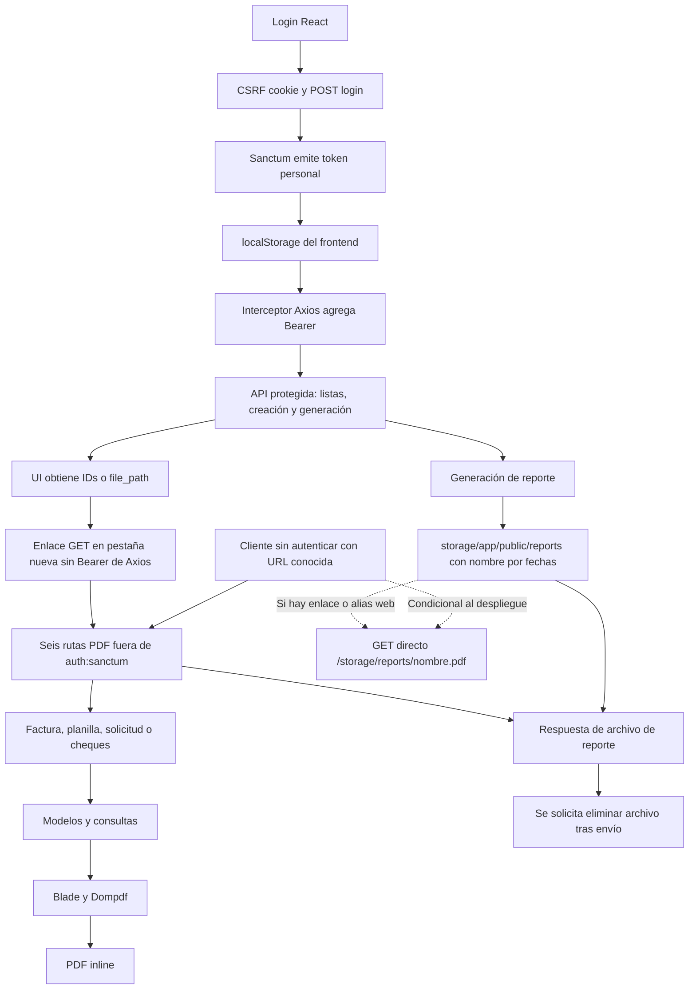

# Auditoría de descargas y autenticación de SMI AJAX

Fecha: 24 de octubre de 2026 (America/Panama). Alcance: revisión estática de `ia-system-cloud` y `ia-system-web`. No se ejecutó la aplicación, Artisan, pruebas, instalaciones, migraciones ni peticiones al servicio desplegado. No se leyeron archivos `.env`, bases de datos, logs, sesiones ni documentos de usuarios. Se consultó documentación pública de dependencias para precisar el contrato de respuesta; no se descargaron dependencias al workspace.

## Resumen ejecutivo

Las seis rutas GET de documentos están fuera de `auth:sanctum`: facturas, planillas, cheques, solicitudes preliminares, cheques preliminares y reportes. Sus controladores tampoco autentican. El código permite solicitar documentos sin token cuando existen los registros/archivos necesarios; la exposición efectiva desde Internet depende de controles externos no inspeccionados. Esto contradice la regla confirmada de que solo usuarios autenticados pueden obtener documentos.

El frontend tiene **15 enlaces de documentos**, todos con `target="_blank"`. Son navegaciones normales y no pasan por el interceptor Axios que añade el Bearer desde `localStorage`. Proteger únicamente las seis rutas rompería esos enlaces en la arquitectura observada. Los reportes tienen un problema adicional: se guardan en `storage/app/public/reports`, con nombres predecibles que colisionan entre filtros, y se eliminan al enviarlos desde la API. Proteger la API no basta si el servidor también sirve ese almacenamiento directamente.

La alternativa inicial mejor ajustada al código es GET autenticado con Axios y apertura del PDF recibido como Blob, condicionada a validar tamaños, visor, impresión y ventanas emergentes. Los reportes requieren además almacenamiento local privado, identificación de cada generación y una política explícita de conservación/reintento. No hace falta S3 ni autorización por propietario/rol: cualquier usuario autenticado debe poder consultar cualquier documento. No se implementó ninguna solución.

## Método, referencias y certeza

- `B:` indica una ruta relativa a `ia-system-cloud`; `F:` a `ia-system-web`. Las referencias `ruta:línea` corresponden al código revisado.
- **Confirmado**: declaración o comportamiento explícito del código/configuración de esta copia. **Inferido**: consecuencia razonable del código o comportamiento de una dependencia. **Condicional**: depende del servidor, navegador o datos no examinados.
- `ANALISIS_PROYECTO.md` se contrastó como antecedente, no como evidencia suficiente. Se corroboraron descargas públicas, colisiones y eliminación de reportes. Su discusión del JS Laravel local no describe el frontend React: este sí conserva un Bearer y tiene interceptor (`F:src/App.js:11`).
- No se encontraron `AGENTS.md` en los proyectos ni en sus directorios ascendentes examinados. No hay `vendor` ni `node_modules` en las raíces observadas; no se instaló nada. Las versiones bloqueadas son Laravel v10.4.1, Sanctum v3.2.1, laravel-dompdf v2.0.1 y Symfony HttpFoundation v6.2.7 (`B:composer.lock:11`, `:1125`, `:1325`, `:3824`).

## Inventario backend

### Middleware efectivo según código

Todas las rutas API llevan prefijo `/api` y grupo `api` (`B:app/Providers/RouteServiceProvider.php:29`). El grupo incluye `ThrottleRequests:api` y `SubstituteBindings`; `EnsureFrontendRequestsAreStateful` está comentado (`B:app/Http/Kernel.php:42`). El límite configurado es 60/minuto por usuario reconocido o IP (`B:app/Providers/RouteServiceProvider.php:43`). La pila global incluye proxies, CORS, mantenimiento, tamaño de solicitud y normalización de entradas (`B:app/Http/Kernel.php:16`). Ninguno de esos componentes exige autenticación.

En la tabla, **M0** significa pila global + grupo `api`, sin `auth:sanctum`; **M1**, lo anterior + `auth:sanctum`. El grupo protegido comienza en `B:routes/api.php:34` y termina antes de las descargas. No se hallaron constructores con middleware adicional ni comprobaciones de usuario en los métodos PDF. La reconstrucción es estática; no se inspeccionó un caché de rutas del despliegue.

| ID | Método y ruta completa | Middleware / declaración | Controlador y origen del documento | Éxito: tipo y disposición | Errores / efectos |
|---|---|---|---|---|---|
| B1 | GET `/api/invoices/{invoice}/download` | M0; `B:routes/api.php:179` | `InvoiceController::pdf`, `B:app/Http/Controllers/InvoiceController.php:195`. Binding `Invoice`; factura, primer detalle, agencia, descripción e idioma desde relaciones; `resources/views/pdf/invoice.blade.php`. Se renderiza al solicitar; no se guarda PDF explícitamente. | 200, `application/pdf`, `inline; filename="invoice_{id}.pdf"`, `:213`. | ID inexistente: 404 por binding (inferido); relaciones/detalle ausentes pueden provocar error de render/500. Sin catch propio. |
| B2 | GET `/api/payrolls/{payroll}/download` | M0; `B:routes/api.php:180` | `PayrollController::pdf`, `B:app/Http/Controllers/PayrollController.php:98`. Binding `Payroll`; consultas de facturas paid/pending, intérpretes, coordinadores y misceláneos por `payroll_id`; plantilla `pdf.fortnightly`, `preview=false`. Sin persistencia explícita. | 200, `application/pdf`, `inline; filename="fortnightly.pdf"`, `:142`. | Diferencia de fechas >15 días: **201 JSON**, `success=false`, `:143`; no es PDF aunque HTTP sea 2xx. Binding inexistente: 404 inferido; fechas/render/BD: excepción no adaptada. |
| B3 | GET `/api/bank-checks/{payroll}/download` | M0; `B:routes/api.php:181` | `BankCheckController::pdf`, `B:app/Http/Controllers/BankCheckController.php:43`. El parámetro es **ID de planilla**, no de cheque. `bankChecks` + `checkDetails`; plantilla `pdf.bank-checks`, `preview=false`; letter/portrait, fuentes locales y recursos remotos. | 200, `application/pdf`, `inline; filename="bank-checks.pdf"`, `:59`. | Binding Payroll: 404 inferido; sin comprobación especial de conjunto vacío ni catch de render/fuentes/imágenes. |
| B4 | GET `/api/requests/{request}/download` | M0; `B:routes/api.php:182` | `RequestController::pdf`, `B:app/Http/Controllers/RequestController.php:316`. Binding **App\Models\Request**; facturas paid/pending por `request_id`; `pdf.fortnightly`, `preview=true`. Sin PDF persistido explícitamente. | 200, `application/pdf`, `inline; filename="fortnightly.pdf"`, `:360`. | >15 días: **201 JSON**, `success=false`, `:361`. Binding: 404 inferido; render/BD sin catch propio. |
| B5 | GET `/api/bank-checks-preview/{request}/download` | M0; `B:routes/api.php:183` | `BankCheckPreviewController::pdf`, `B:app/Http/Controllers/BankCheckPreviewController.php:41`. ID de solicitud; `bankCheckPreviews` + `checkDetailPreviews`; `pdf.bank-checks`, `preview=true`; letter/portrait. | 200, `application/pdf`, `inline; filename="bank-checks.pdf"`, `:57`. | Binding de solicitud: 404 inferido; conjunto vacío sin error específico; render sin catch propio. |
| B6 | GET `/api/reports/{report}/download` | M0; `B:routes/api.php:184` | `ReportController::pdf($file_name)`, `B:app/Http/Controllers/ReportController.php:739`. `{report}` es **nombre de archivo**, no binding del modelo Report. Lee `storage/app/public/reports/{file_name}`. | `response()->file($path)`, `:743`: respuesta binaria de archivo; MIME esperado `application/pdf`, detectado por framework; **Content-Disposition no se fija explícitamente**. No asegurar `attachment` ni filename a partir del código local. | `deleteFileAfterSend(true)`: solicita borrar el archivo tras envío. Ausente/ilegible: excepción de archivo; sin traducción propia a 404. Estado final depende del framework/handler. Sin allowlist explícita de nombres/extensiones ni verificación canónica de confinamiento. No se confirmó traversal explotable. |
| B7 | POST `/api/reports/generate` | M1; `B:routes/api.php:129` | `ReportController::generate`, `B:app/Http/Controllers/ReportController.php:84`. Catálogo Report + User + filtros; genera uno de cuatro PDFs y lo guarda. | 200 JSON: `file_name`, `file_path`, `status`, `message`; sin disposición de archivo. URL absoluta por `url('api/reports/.../download')`. | Tipo no contemplado: 404 (`:124`); sin datos: 404; rango inválido en mensual/mensual por pagos: 400; fechas, modelos o escritura pueden lanzar excepciones. No hay validación integral del request. |
| B8 | GET `/api/last-payroll` | M0; `B:routes/api.php:185` | `PayrollController::lastPayroll`, `B:app/Http/Controllers/PayrollController.php:39`: último registro no cancelled por ID. | Serialización de modelo/JSON esperado, sin disposición; no entrega PDF. | Sin política de autenticación; respuesta sin registro no definida explícitamente. Se incluye por su relación con el asistente de planillas. |

Los encabezados de B1–B5 están corroborados por `stream()` en el [código oficial laravel-dompdf v2.0.1](https://raw.githubusercontent.com/barryvdh/laravel-dompdf/v2.0.1/src/PDF.php): crea respuesta 200 con PDF inline. Esto describe la dependencia bloqueada, no una captura HTTP real. Para B6 no se obtuvo el fuente remoto de las versiones exactas de Laravel/Symfony; se mantiene explícita esa limitación. `B:app/Exceptions/Handler.php:38` no adapta errores de documentos. Un error no tiene por qué devolver PDF: puede ser JSON/HTML según negociación y configuración.

### Las cuatro generaciones de reportes

Todos comparten directorio `storage/app/public/reports/`. En los nombres, `{inicio}` y `{fin}` se formatean `m-d-Y`; no se incluyen usuario, idioma, persona ni un identificador único.

| report_id | Generación, plantilla y formato | Nombre | Evidencia |
|---|---|---|---|
| 1 | `monthlyServiceReport`, `pdf.monthly`, A4 horizontal | `monthly_service_report_{inicio}_{fin}.pdf` | `B:app/Http/Controllers/ReportController.php:132`, `:267`, `:269`, `:273` |
| 2 | `annualServiceReport`, `pdf.annual`, papel/orientación de configuración | `annual_service_report_{inicio}_{fin}.pdf` | `B:app/Http/Controllers/ReportController.php:279`, `:392`, `:394`, `:398` |
| 3 | `cumulativeServiceReport`, `pdf.cumulative`, papel/orientación de configuración | `cumulative_service_report_{inicio}_{fin}.pdf` | `B:app/Http/Controllers/ReportController.php:407`, `:514`, `:516`, `:520` |
| 4 | `monthlyServiceReportByPaymentPeriod`, `pdf.monthly-by-payment`, A4 horizontal | `monthly_service_report_by_payment_period_{inicio}_{fin}.pdf` | `B:app/Http/Controllers/ReportController.php:526`, `:719`, `:721`, `:725` |

Los cuatro métodos devuelven 404 sin datos (`:263`, `:388`, `:510`, `:715`). Los mensuales verifican número de meses (`:175`, `:569`). La selección usa `match ($reportId)` con enteros (`:119`): el tipo JSON de `report_id` importa. Los reportes consultan/agregan datos de servicios/personas/períodos; la descarga B6 ya no vuelve a consultar esos filtros ni genera un documento nuevo. `user_id` se toma del cliente (`:89`, `:101`); no constituye control de acceso ni debe usarse para imponer propiedad en esta fase posterior.

### Vistas y archivos servidos

- Factura: `B:resources/views/pdf/invoice.blade.php:1`; quincenal: `B:resources/views/pdf/fortnightly.blade.php:8`; cheques: `B:resources/views/pdf/bank-checks.blade.php:8`. Son plantillas alimentadas por modelos/consultas, no enlaces a PDFs preexistentes. No se reproducen sus datos financieros ni personales.
- En quincenal, `:62` condiciona el contenido a que existan **intérpretes y coordinadores**: probar grupos con solo uno de ellos. En cheques, `:108` condiciona el contenido a cheques existentes; `:357` distingue detalle preliminar/definitivo. Un PDF vacío puede ser respuesta técnicamente válida.
- Cheques usa fuentes de `storage/fonts` (`:12`, `:17`, `:23`) e imagen vía `asset('images/vystar.jpg')` (`:131`). Los controladores habilitan recursos remotos y fijan chroot. La fuente regular coincide con `Calibri-Regular.ttf`; la fuente bold se enumera `Calibri-Bold.TTF` y se referencia `Calibri-Bold.ttf`: comprobar sensibilidad a mayúsculas del servidor. No se abrieron imágenes ni metadatos de fuentes.
- `B:config/dompdf.php:48`, `:67`, `:81`, `:172`, `:181`, `:267`: fuentes locales, temporales del sistema, chroot de proyecto, A4 vertical por defecto y recursos remotos habilitados. Los documentos inline no se guardan explícitamente, pero el motor puede producir cachés/temporales. No se afirma ausencia de todo archivo temporal.
- `B:config/filesystems.php:35`, `:41`, `:73`: disco local en `storage/app`, disco público en `storage/app/public`, enlace configurado `public/storage` → `storage/app/public`. La escritura de reportes usa `storage_path` explícito, por lo que cambiar solamente `FILESYSTEM_DISK` no la privatiza.
- La enumeración local de `public` y `storage/app/public` no encontró PDFs, directorio reports ni enlace `public/storage`. Eso no demuestra ausencia en producción: `B:.gitignore:5` excluye el enlace. Si el enlace/alias existe, la ruta web habitual sería **`/storage/reports/{file_name}`**, sin paso por Sanctum; `/public` normalmente es document root, no parte literal de la URL.
- `B:public/.htaccess:18` deja archivos/directorios existentes fuera de la reescritura al front controller. Deshabilitar índices no bloquea obtener un archivo de nombre conocido. No se encontró ruta web documental adicional (`B:routes/web.php:16`, solo welcome), ni otros emisores de archivos en controladores/rutas examinados.
- El backup programado escribe en `storage/app/backup` (`B:app/Console/Commands/Auto_Backup_Database.php:43`), fuera del disco público configurado y sin endpoint de descarga encontrado. No se ejecutó ni se accedió a backups. No hay evidencia de exposición HTTP de ese directorio.

## Inventario frontend y correspondencia

Base literal del código: **`H = https://cloud.smiajax.com`**, `F:src/config.json:3`. El frontend fija `https://smiajax.com` en `:2`. Son orígenes distintos. Las URLs siguientes son expresiones exactas del código, no URLs probadas; las barras finales se conservan.

En **cada uno de los 15 enlaces**: método GET de navegador, sin Axios/fetch ni `Authorization` añadido por JS; `target="_blank"`; cookies solo las que el navegador tenga y permita para ese destino, sin sesión API demostrada. No hay catch HTTP, indicador de descarga ni validación de MIME en la acción; no hay Blob ni object URL y, por tanto, no hay revocación. Los enlaces tienen `noreferrer` o `noopener noreferrer`. La carga previa de listas/generación sí usa Axios autenticado, lo que no autentica la navegación posterior.

| Acción/pantalla | Referencia F | URL construida | Backend | Atributo download / condición |
|---|---|---|---|---|
| Administración de facturas, Download | `src/pages/InvoicePage.js:265` | `${H}/api/invoices/${id}/download` | B1 | No |
| Historial, Download de paid | `src/pages/ServiceHistory.js:338` | `${H}/api/invoices/${id}/download` | B1 | No; rama paid `:326` |
| Historial, Download de pending | `src/pages/ServiceHistory.js:366` | `${H}/api/invoices/${id}/download` | B1 | No; rama pending `:357` |
| Nuevo servicio, factura al finalizar | `src/pages/NewServicePage.js:1595` | `${H}/api/invoices/${invoiceId}/download/` | B1 | Sí; `invoiceId` del alta |
| Payments, Download de planilla | `src/pages/PayrollPage.js:394` | `${H}/api/payrolls/${id}/download` | B2 | No; status created `:389` |
| Payments, Checks | `src/pages/PayrollPage.js:404` | `${H}/api/bank-checks/${id}/download` | B3 | No; mismo ID de planilla |
| Modal de planilla, Download payroll | `src/pages/PayrollPage.js:553` | `${H}/api/payrolls/${payroll.id}/download/` | B2 | Sí; apertura del modal no confirmada como funcional |
| Modal de planilla, cheques | `src/pages/PayrollPage.js:572` | `${H}/api/bank-checks/${payroll.id}/download/` | B3 | Sí; misma reserva de alcanzabilidad |
| Solicitud pending, Download | `src/pages/RequestPage.js:486` | `${H}/api/requests/${id}/download` | B4 | No; status pending `:481` |
| Solicitud pending, Checks | `src/pages/RequestPage.js:495` | `${H}/api/bank-checks-preview/${id}/download` | B5 | No |
| Solicitud completed, Download | `src/pages/RequestPage.js:519` | `${H}/api/requests/${id}/download` | B4 | No; status completed `:514` |
| Solicitud completed, Checks | `src/pages/RequestPage.js:529` | `${H}/api/bank-checks-preview/${id}/download` | B5 | No; continúa siendo el preliminar por solicitud |
| Modal de nueva solicitud, Download request | `src/pages/RequestPage.js:690` | `${H}/api/requests/${request.id}/download/` | B4 | Sí |
| Modal de nueva solicitud, cheques preliminares | `src/pages/RequestPage.js:709` | `${H}/api/bank-checks-preview/${request.id}/download/` | B5 | Sí |
| Generar reporte | `src/pages/ReportPage.js:185` | POST `${H}/api/reports/generate` | B7 | Axios + Bearer; JSON de filtros; no abre pestaña en este paso |
| Modal de reporte, PDF | `src/pages/ReportPage.js:664` | `${file.file_path}` | B6 | Sí; URL absoluta devuelta por backend, no reconstruida con H |

La tabla tiene 16 acciones: 15 enlaces GET y una generación POST. No se encontraron otras descargas con `window.open`, `location.href`, fetch documental, Axios binario, `responseType: blob`, `URL.createObjectURL` o `URL.revokeObjectURL` en `src`. El fetch de `F:src/serviceWorker.js:99` verifica el service worker; `F:src/index.js:23` lo desregistra. Las recargas de otras páginas no son descargas documentales.

El atributo `download` no garantiza descargar: opera con restricciones de origen, y estos enlaces normalmente cruzan de smiajax.com a cloud.smiajax.com. El navegador puede abrir el PDF inline según respuesta/configuración; debe comprobarse por navegador. Véase la [documentación de `<a>` de MDN](https://developer.mozilla.org/en-US/docs/Web/HTML/Reference/Elements/a). Las URLs con barra final pueden sufrir 301 por `B:public/.htaccess:15`; no se observó la respuesta real.

### Cadenas de datos previas y rutas sin vínculo confirmado

1. **Nueva factura:** `F:src/pages/NewServicePage.js:657` hace POST autenticado `/api/invoices`; `B:app/Http/Controllers/InvoiceController.php:171` devuelve el ID, `F:...NewServicePage.js:659` lo guarda y el paso final lo usa en B1. Historial lista `/api/invoices` (`F:src/pages/ServiceHistory.js:171`) y reutiliza cada ID.
2. **Solicitud y preliminares:** Review trae `/api/requests/review/{inicio}/{fin}` (`F:src/pages/RequestPage.js:264`); selección → POST `/api/requests` en `F:src/sections/@payroll/table/ReviewListToolbar.js:96`; respuesta `data.request` → `setRequest`/`setOpenRequest` (`:102`), luego B4/B5. El listado usa `/api/requests` (`F:src/pages/RequestPage.js:189`). La consulta/render de B4/B5 se reconstruye desde sus relaciones, no desde un PDF persistido.
3. **Planilla y cheques definitivos:** completar solicitud usa PUT `/api/requests/new-status/{id}` (`F:src/pages/RequestPage.js:335`, `B:app/Http/Controllers/RequestController.php:377`); el listado Payments obtiene `/api/payrolls` (`F:src/pages/PayrollPage.js:182`) y usa sus IDs para B2/B3. El asistente C&R usa POST `/api/car-wizard`, GET `/api/last-payroll` y datos de planillas (`F:src/pages/CAndRWizardPage.js:282`, `:300`, `:316`); no tiene enlace PDF propio encontrado.
4. **Modal de planilla dudoso:** `F:src/pages/PayrollPage.js:632` pasa `getPayrolls`, `setPayroll`, `setOpenPayroll` a `ReviewListToolbar`, pero el componente consume `getRequests`, `setRequest`, `setOpenRequest` y hace POST `/api/requests` (`F:src/sections/@payroll/table/ReviewListToolbar.js:46`, `:96`). La estructura del modal y sus URLs existe; no se puede afirmar un camino de generación exitoso hacia él. El POST podría persistir una solicitud antes de que falle el callback: no probarlo sobre datos reales. Esta observación es ajena a la protección PDF, pero afecta su regresión.
5. **Reportes:** lista `/api/reports` (`F:src/pages/ReportPage.js:226`), usuario elige catálogo/filtros, POST B7 con ID y fechas/persona/idioma (`:185`), `setFile(response.data)` (`:197`), enlace B6 (`:664`). El click cierra el modal y borra su estado antes de saber si el GET funcionó (`:669`). No hay error de descarga observable en la SPA.
6. **Rutas huérfanas:** ninguna de las seis rutas PDF carece de consumidor textual. `/api/reports/{report}` GET, método `show` vacío (`B:routes/api.php:126`, `B:app/Http/Controllers/ReportController.php:734`), no es la descarga ni un historial de archivos; no se encontró consumo GET con ese formato. Las rutas CRUD de bank-checks no son el origen de los botones Checks; estos apuntan al PDF por planilla. No se infiere ausencia de clientes externos por no encontrarlos en React.

## Autenticación real y comportamiento de nueva pestaña

1. Login React solicita `sanctum/csrf-cookie` y luego POST `api/login` (`F:src/sections/auth/login/LoginForm.js:33`). No configura `withCredentials`. Obtener esa cookie por sí solo no demuestra una sesión autenticada.
2. Backend valida credenciales con `Auth::attempt` (`B:app/Http/Controllers/AuthController.php:31`). Si encuentra un token previo por `tokenable_id`, elimina el primero y devuelve 401 sin emitir otro (`:39`); si no, emite `createToken(...)->plainTextToken` (`:52`) y responde con token e ID. El modelo User incorpora `HasApiTokens` (`B:app/Models/User.php:13`). No se muestra ningún valor de credencial/token.
3. React guarda token e ID en `localStorage` (`F:src/sections/auth/login/LoginForm.js:40`). `F:src/App.js:11` fija baseURL y añade `Authorization: Bearer …` a **todas las solicitudes del Axios global**, incluso públicas; sin token construye `Bearer null`. No se encontró interceptor de respuesta, renovación automática ni cliente binario separado. LocalStorage permite leer el token a JS del mismo origen: impacto potencial ante XSS, no prueba de XSS existente.
4. `PrivateRoute` protege visualmente `/dashboard` (`F:src/routes.js:38`), pero devuelve children antes de finalizar su efecto (`F:src/components/auth/PrivateRoute.js:32`). Consulta GET `/api/validate-token-access` con **token e ID en query string** (`:15`), además del encabezado Axios. PublicRoute repite ese patrón (`F:src/components/auth/PublicRoute.js:11`). Estas guardas no protegen la API ni los archivos.
5. `/api/validate-token-access` es público (`B:routes/api.php:176`), usa `findToken`, compara `tokenable_id` **antes** de verificar null y devuelve el token (`B:app/Http/Controllers/AuthController.php:254`). No comprueba `expires_at`, edad ni la validez completa del guard Sanctum. Puede fallar ante token inexistente y no es prueba equivalente a pasar `auth:sanctum`. El `.catch` de PublicRoute devuelve una función async sin invocarla (`F:src/components/auth/PublicRoute.js:22`), por lo que su limpieza/logout no se ejecuta como parece pretender.
6. Expiración global Sanctum: `null` (`B:config/sanctum.php:49`); emisión sin vencimiento explícito. Existe columna nullable `expires_at` (`B:database/migrations/2019_12_14_000001_create_personal_access_tokens_table.php:21`), pero no se inspeccionaron registros. No hay refresh token encontrado. Logout autenticado elimina todos los tokens del usuario (`B:app/Http/Controllers/AuthController.php:70`); React solo borra localStorage tras resolver el POST y no maneja su fallo (`F:src/layouts/dashboard/header/AccountPopover.js:40`).
7. Reset-password crea otro token sin revocar explícitamente los de acceso existentes (`B:app/Http/Controllers/AuthController.php:176`); React lo guarda y navega a login (`F:src/sections/auth/password/ResetForm.js:41`). Cambio de contraseña normal tampoco elimina tokens (`B:app/Http/Controllers/UserController.php:68`). Son observaciones del ciclo de acceso, no una auditoría completa de recuperación/administración de usuarios.
8. Navegación normal con `<a target="_blank">` no ejecuta Axios ni toma el token del localStorage para convertirlo en header. El backend es otro origen y no lee el localStorage del frontend. Pueden enviarse cookies aplicables, pero el API no inicia sesión mediante middleware stateful en la configuración observada. Por eso una pestaña abierta puede descargar hoy sin autenticarse, y fallaría si solo se añade `auth:sanctum`.
9. `B:config/auth.php:40` define guard web de sesión; el grupo web sí tiene sesión/CSRF, el API no (`B:app/Http/Kernel.php:33`). `B:config/session.php:171`, `:184`, `:199` declaran Secure mediante variable, HttpOnly true y SameSite lax; los valores efectivos de entorno no se leyeron. Son configuración disponible, no evidencia de sesión SPA funcional.
10. CORS permite `api/*`, orígenes/métodos/headers comodín, credentials true y ningún header expuesto (`B:config/cors.php:18`). CORS no bloquea navegación directa ni clientes fuera del navegador. Para Blob con Bearer hay que verificar preflight Authorization y errores; para leer Content-Disposition en JS habría que exponerlo expresamente. Para cookies entre orígenes hacen falta orígenes explícitos y revisar credentials, dominios, sesión y CSRF; no asumir que esta combinación actual basta.
11. Si se protegen los PDFs, una navegación sin `Accept: application/json` puede intentar redirigir a `route('login')` (`B:app/Http/Middleware/Authenticate.php:15`), nombre no declarado en las rutas revisadas. Hay riesgo de error de redirección en lugar de un 401 claro. Es una condición de la futura protección, no un fallo hoy demostrado en las rutas públicas.

## Diagrama del flujo actual



## Hallazgos por criticidad y certeza

| ID | Criticidad / certeza | Hallazgo e impacto | Evidencia / límite |
|---|---|---|---|
| H1 | Crítica / confirmado en código; exposición externa condicional | Seis descargas sin autenticación permiten obtener documentos por ID/nombre sin token. Nombres o IDs no sustituyen autenticación. | B1–B6 y pila M0. No se probaron URLs desplegadas. |
| H2 | Alta / condicional | Reportes en almacenamiento público pueden eludir cualquier futura protección de la API mediante `/storage/reports/...`. | Escrituras B7, filesystem público y .htaccess; enlace ausente local, despliegue desconocido. |
| H3 | Alta / confirmado; carrera inferida | Nombres por tipo/fechas colisionan entre generaciones con filtros diferentes: sobrescritura, respuesta con filtros ajenos al pedido o borrado de otra generación. No es una vulneración de propiedad, pues el acceso global autenticado está permitido; sí de integridad del resultado. | Cuatro nombres y `save()` + B6. Concurrencia no ejecutada. |
| H4 | Alta / confirmado | Token de acceso en query de validación: posible persistencia en registros de acceso, proxy, observabilidad y herramientas. No se inspeccionaron esos registros. No afirmar historial de navegación principal: es XHR. | PrivateRoute/PublicRoute y validateTokenAccess. |
| H5 | Alta / confirmado; efecto de navegador inferido | Añadir auth solo en backend rompe los 15 enlaces sin Bearer. La UI autenticada no autentica una navegación. | Tabla frontend y App.js. |
| H6 | Media / confirmado; efecto de envío condicional | GET de reporte solicita borrar el archivo: recargar, reabrir, compartir y reintentar pueden fallar. No equivale a un token seguro de un solo uso: no hay consumo atómico ni identidad/TTL. | `ReportController.php:743`; entrega real y descarga parcial no verificadas. |
| H7 | Media / confirmado | Planilla/solicitud pueden devolver 201 JSON en lugar de PDF; frontend no verifica tipo ni muestra ese fallo en la SPA. | `PayrollController.php:143`, `RequestController.php:361`. |
| H8 | Media / confirmado | Validación manual incompleta, acceso antes de comprobar null y limpieza de PublicRoute no ejecutada; UI puede conservar estado/token inválido. | AuthController:254; PublicRoute:22; PrivateRoute:32. |
| H9 | Media / confirmado; riesgo condicional | Tokens sin vencimiento global ni revocación automática al cambiar/resetear contraseña; localStorage amplía impacto si ocurre XSS. Login con token previo revoca primero y rechaza intento, lo que afecta pruebas con varias sesiones. | Ciclo de autenticación descrito; no se demuestra XSS ni tokens reales vigentes. |
| H10 | Media / confirmado | `/api/last-payroll` público expone metadatos de una planilla. No es PDF, pero está relacionado con el portal administrativo. | B8; consumidor CAndRWizardPage:300. |
| H11 | Media / confirmado en estructura; fallo runtime inferido | Modal de planilla recibe nombres de callbacks incompatibles; camino desde generación no confirmado y POST puede persistir antes de fallar JS. | PayrollPage:632 y ReviewListToolbar:46. |
| H12 | Media / confirmado; explotabilidad no confirmada | Descarga de reporte concatena nombre proporcionado sin validación canónica/allowlist explícita y solicita borrarlo. Evaluar confinamiento y nombres codificados; no se demuestra lectura/borrado arbitrario. | ReportController:739 y segmento de ruta B6; normalización de proxy/router desconocida. |
| H13 | Baja / inferido | Fuentes con diferencia de extensión/mayúsculas, recursos remotos, PDFs vacíos por condiciones de plantilla y cierre anticipado del modal dificultan diagnósticos/regresión. | Vistas, setOptions y ReportPage:669. |

No se propone agregar filtros por usuario/propietario/rol. La falta de esos filtros **no es un hallazgo**, conforme a la regla de negocio. La autenticación debe exigirse a todo documento y a toda vía de acceso a su archivo, aunque el usuario conozca el ID o nombre.

## Alternativas, sin implementación

| Criterio | Axios/fetch con Bearer → Blob | URL temporal opaca | Cookies de sesión seguras |
|---|---|---|---|
| Ajuste a evidencia | Alto: Axios global y Bearer ya existen; sustituye enlaces de las seis familias. | Útil si PDFs grandes o navegación/visor requieren URL HTTP directa; infraestructura de tickets no existe en lo revisado. | Menor inicialmente: stateful API desactivado y frontend sin credentials configuradas. |
| Backend | Proteger seis GET; reportes privados; errores claros, MIME y caché adecuados. No exige cambiar Sanctum a sesiones. | Emisión autenticada, tickets de alta entropía, documento/generación y usuario emisor, vencimiento, almacenamiento seguro, canje y consumo atómico si son de un uso; protección contra repetición y abuso. | Activar y verificar sesión SPA, middleware stateful, login/logout, CSRF, orígenes y dominios. Proteger todas las descargas y privatizar reportes. |
| Frontend | Solicitud binaria autenticada, pestaña reservada durante gesto de usuario, carga/error visibles, comprobación de HTTP y MIME, object URL y liberación en momento seguro; soporte de guardar/impresión. | Pedir ticket vía Axios y navegar a URL de canje; gestionar vencimiento, nueva emisión, ventanas, fallos y enlaces copiados. | Migrar login/guardas/logout, credentials y CSRF; enlaces normales pueden conservarse si la cookie autentica el endpoint. |
| Nueva pestaña / inline | PDF Blob abre en visor local del navegador; no conserva URL HTTP de backend ni necesariamente filename original. Reservar pestaña antes del await evita bloqueos comunes; comprobar navegadores. | Mantiene navegación HTTP y headers inline/attachment; visores con Range o varias peticiones complican un único uso estricto. | Conserva URL HTTP y streaming/Range según respuesta; navegador envía cookie válida al destino. |
| Expiración / revocación | Token se comprueba al pedir bytes. Revocar después no retira un Blob ni una copia descargada. Revocar object URL libera recurso local, no sustituye expiración del token. | TTL y revocación del ticket deben definirse; logout/revocación de sesión deberían invalidar tickets según política. Los bytes entregados siguen disponibles. | Expiración y revocación de sesión; copias/cache ya entregadas no se recuperan. |
| Recargar / compartir | Blob no es enlace permanente ni compartible de forma fiable; recarga depende de su ciclo de vida. Para reabrir, usar acción autenticada nuevamente. | Puede recargarse dentro del TTL si es reutilizable; un uso impide recarga y puede chocar con prefetch/visor. Compartirlo puede dar acceso a otro portador. | Otro navegador sin sesión debe ser rechazado; otro usuario autenticado sí puede abrir por regla de negocio. |
| Memoria / tamaño | Se recibe normalmente el PDF completo antes de abrirlo; medir memoria móvil, latencia, duplicación y render del servidor. `stream()` de Dompdf ya genera contenido en memoria. | Mejor para entrega HTTP directa de archivos grandes; generación/almacenamiento y retención siguen requiriendo control. | Entrega directa; más trabajo de autenticación global. |
| Complejidad y riesgos | Baja/media para documentos dinámicos; media para reportes por colisiones/eliminación. No poner Bearer en URL. | Alta: tickets, carreras, limpieza, registros de URL y semántica de visor. No usar el token Sanctum como ticket. | Alta respecto a este frontend; requiere estrategia de transición y regresión completa de autenticación. |

**Límite importante de las URLs temporales:** vincular el ticket al usuario que lo emitió no autentica automáticamente a quien lo canjea. Una URL que por sí sola concede bytes funciona como credencial al portador; quien la recibe puede descargar sin sesión del portal mientras sea válida. Bajo la regla estricta «un usuario no autenticado nunca debe obtenerlos por URL directa», esa variante no cumple si admite canje anónimo. Solo considerarla con una comprobación adicional de identidad autenticada en el canje, o con una aceptación explícita de una regla de negocio distinta. Una firma/TTL por sí solos no solucionan esta incompatibilidad. Exigir Bearer en el canje vuelve a requerir petición JS; exigir sesión se acerca a la tercera opción.

### Propuesta preferente condicionada

1. Para B1–B5, evaluar primero Axios autenticado + Blob y proteger las rutas con Sanctum. Preservar apertura de pestaña desde click, permitir impresión/guardar y ofrecer error claro. No usar un cambio aislado de middleware ni transportar el Bearer en query. Pedir PDF con negociación que garantice errores 401 JSON; rechazar el 201 JSON existente como error documental, aunque Axios lo trate como éxito HTTP.
2. Para reportes, mantener almacenamiento **local** pero en ubicación privada fuera de `storage/app/public`, confinar acceso a artefactos PDF y distinguir cada generación para conservar sus filtros. Autenticar descarga; acordar TTL, limpieza y reintentos antes de conservar o sustituir `deleteFileAfterSend`. Un UUID/nombre impredecible mejora identificación, pero no reemplaza autenticación. No añadir propiedad como requisito de acceso.
3. Elegir Blob solo después de medir PDF realista máximo y validar visor/ventanas en navegadores objetivo. Si falla por tamaño/Range o se exige URL recargable del visor, reevaluar sesiones seguras o una ruta de visor autenticada. Tickets con canje anónimo quedan descartados por la regla actual, aunque tengan TTL.
4. Revisar todas las vías estáticas y caches del despliegue; proteger la API no revoca copias estáticas/CDN ya existentes. Para futuras respuestas autenticadas evaluar `Cache-Control: private, no-store` y el comportamiento del visor. No hay headers de caché específicos declarados por estos controladores; no se afirma la ausencia de defaults de framework/proxy.

## Pruebas futuras recomendadas

Ejecutar en entorno aislado con fixtures sintéticos y autorización para mutaciones. **No se ejecutaron durante esta auditoría.** B6 y B7 tienen efectos sobre archivos: tampoco tratarlos como pruebas de lectura inocuas. No crear datos con información personal real.

| Escenario | Cobertura mínima | Resultado objetivo / evidencia |
|---|---|---|
| Usuario A válido | B1–B6 y generación de los cuatro reportes | 200 PDF válido, MIME correcto, nombre/inline esperado; contenidos y formatos comparados con base actual. |
| Usuario B válido, documentos creados por A | Todas las familias y artefactos de reporte | Acceso permitido: confirma acceso global autenticado sin restricciones de propiedad/rol. |
| Sin token/cookie | URLs API conocidas y copiadas, incógnito, cliente HTTP, generación | 401 sin bytes de documento; error estable y sin redirección rota a login. |
| Token inválido, expirado y revocado | Header, guardas y descarga; revocar por logout/segundo login | Rechazo uniforme; no confundir findToken con validación Sanctum. Simular expiración configurada o `expires_at` solo en fixtures. |
| Pestaña nueva | Los 15 enlaces/acciones, clicks rápidos, bloqueador, Chrome/Firefox/Safari y móvil | Se abre la pestaña con PDF o mensaje útil; no quedan pestañas en blanco ni se pierde la sesión. |
| Recargar, reabrir, compartir | Documentos dinámicos, reporte ya servido, object URL revocada | Comportamiento explícito y acorde al mecanismo elegido; enlace API compartido solo funciona con usuario autenticado. |
| Estático público | `/storage/reports/{nombre}`, aliases/document roots/CDN, archivo histórico y nombres conocidos | Ningún PDF accesible anónimamente; verificación aislada del servidor, no solo de Laravel. |
| Archivo/ID inexistente | B1–B6; nombre no PDF, codificaciones y segmentos anómalos | 404 o error contractual seguro, sin lectura/borrado fuera de directorio ni trazas sensibles. No asumir traversal confirmado. |
| Error de dominio | Fechas >15 días B2/B4, sin datos, rango inválido, report_id string/desconocido | Error visible; JSON/HTML nunca se interpreta como PDF ni se abre como descarga exitosa. |
| Errores operativos | BD/render, disco lleno/no escribible, imagen/fuente ausente, 429, timeout, offline, CORS | UI recuperable y mensaje correcto, sin borrar prematuramente la única posibilidad de reintento. |
| Reportes concurrentes | Mismo tipo/fechas con idioma/persona diferente, dos usuarios, doble click | Cada generación corresponde a sus filtros; no sobrescrituras ni eliminación cruzada. |
| Reporte y envío | Segunda lectura, GET concurrente, desconexión, HEAD/Range, visor que reconsulta | Retención/consumo definido; no confundir borrar archivo con autorización o consumo seguro de ticket. |
| Tamaño y rendimiento | Pequeño, representativo y máximo observado más margen; móvil | Medir tiempo, RAM servidor/cliente, bloqueo de ventana e impresión; determinar viabilidad Blob. No se inventa un límite de MB. |
| Ciclo Blob | Varios documentos, cambio de ruta, cierre visor, error, reintento | Revocación sin romper descarga/impresión/guardar; sin crecimiento continuo de memoria. |
| Credenciales y registros | Proxy/app/analítica con fixtures y CORS preflight | Sin Sanctum Bearer en URL; headers accesibles solo cuando se requieren, sin tokens en errores. |
| Regresión contable/visual | Factura, solicitud pending/completed, planilla created, cheque final/preliminar; cuatro reportes | Totales, filtros, leyendas Preview/Payroll, páginas, letter/A4, orientación, MICR/fuentes/imágenes; casos sin coordinadores/intérpretes/cheques. |
| Origen de modales | Nueva solicitud y modal de planilla/toolbar | Confirmar creación y callbacks; evitar duplicar solicitudes si el callback falla después del POST. |

## Archivos previstos para una fase posterior

Lista exacta para la alternativa preferente, sujeta a la validación indicada. No es un parche y no obliga a modificar todos los archivos de autenticación en el mismo cambio.

### Núcleo de protección y apertura autenticada

| Repositorio / archivo | Cambio que habría que diseñar |
|---|---|
| `ia-system-cloud/routes/api.php` | Proteger las seis descargas; evaluar también last-payroll como endpoint administrativo. |
| `ia-system-cloud/app/Http/Controllers/ReportController.php` | Almacenamiento privado, identidad de generación, confinamiento y respuesta/retención/errores. |
| `ia-system-cloud/app/Http/Controllers/PayrollController.php` | Contrato no-PDF de rango inválido y errores de descarga. |
| `ia-system-cloud/app/Http/Controllers/RequestController.php` | Mismo contrato para preliminar. |
| `ia-system-cloud/app/Http/Middleware/Authenticate.php` | Respuesta no autenticada consistente para documentos/API, sin depender de ruta login inexistente. |
| `ia-system-web/src/pages/InvoicePage.js` | Migrar un enlace. |
| `ia-system-web/src/pages/ServiceHistory.js` | Migrar dos enlaces. |
| `ia-system-web/src/pages/NewServicePage.js` | Migrar enlace de resultado de factura. |
| `ia-system-web/src/pages/PayrollPage.js` | Migrar cuatro enlaces; diagnosticar alcanzabilidad del modal. |
| `ia-system-web/src/pages/RequestPage.js` | Migrar seis enlaces. |
| `ia-system-web/src/pages/ReportPage.js` | Migrar descarga de file_path, errores y ciclo del modal/reintento. |
| `ia-system-web/src/utils/documentDownload.js` (nuevo propuesto) | Centralizar solicitud binaria, ventana, MIME, errores y ciclo de object URL. No creado en esta fase. |
| `ia-system-cloud/tests/Feature/DocumentDownloadAuthenticationTest.php` (nuevo propuesto) | Verificar rechazo anónimo y acceso de cualquier usuario autenticado a las seis familias. |
| `ia-system-cloud/tests/Feature/ReportDownloadLifecycleTest.php` (nuevo propuesto) | Aislamiento por generación, confinamiento, concurrencia/retención y errores con filesystem de pruebas. |

Las plantillas, `InvoiceController`, `BankCheckController` y `BankCheckPreviewController` no necesitan cambios de autorización por documento si el middleware protege sus rutas; solo entrarían al alcance si las pruebas detectan errores de contenido/render. No hace falta modificar `config/filesystems.php` si se usa una ubicación privada local explícita; sí habría que hacerlo si se opta por un disco privado dedicado. La ubicación nueva de reportes y la limpieza de archivos públicos existentes serían trabajo operativo posterior autorizado, no acciones realizadas aquí.

### Correcciones relacionadas y alternativas condicionales

- Higiene de validación de token: `ia-system-cloud/routes/api.php`, `ia-system-cloud/app/Http/Controllers/AuthController.php`, `ia-system-web/src/components/auth/PrivateRoute.js`, `ia-system-web/src/components/auth/PublicRoute.js`; eliminar query sensible y usar validación autenticada real.
- Política de vencimiento/revocación, si se aprueba cambiarla: `ia-system-cloud/config/sanctum.php`, `ia-system-cloud/app/Http/Controllers/AuthController.php`, `ia-system-cloud/app/Http/Controllers/UserController.php`; UI de errores/logout en `ia-system-web/src/App.js` y `ia-system-web/src/layouts/dashboard/header/AccountPopover.js`.
- Modal de planilla: `ia-system-web/src/pages/PayrollPage.js` y `ia-system-web/src/sections/@payroll/table/ReviewListToolbar.js`; arreglarlo requiere definir la acción correcta sin alterar el flujo de solicitudes por accidente.
- Encabezado filename leído por Blob: `ia-system-cloud/config/cors.php`, solo si se conserva Content-Disposition como fuente de nombre. No es requisito para un Blob PDF con nombre gestionado por UI.
- Variante cookies: además de las rutas/controlador de auth, `ia-system-cloud/app/Http/Kernel.php`, `ia-system-cloud/config/sanctum.php`, `ia-system-cloud/config/session.php`, `ia-system-cloud/config/cors.php`, `ia-system-web/src/App.js`, `ia-system-web/src/sections/auth/login/LoginForm.js`, `ia-system-web/src/sections/auth/password/ResetForm.js` y las guardas/logout anteriores. Variables a configurar, sin leer valores: `APP_URL`, `SANCTUM_STATEFUL_DOMAINS`, `SESSION_DOMAIN`, `SESSION_SECURE_COOKIE`, `SESSION_DRIVER`, `SESSION_LIFETIME`.
- Variante tickets: nuevos controlador/servicio de emisión y canje y posible persistencia/limpieza; **no hay lista cerrada de archivos legítima sin resolver antes la incompatibilidad del canje anónimo y seleccionar almacenamiento**. No se propone una migración concreta ni código anticipado.
- Reglas de servidor/CDN: no se identificó un archivo real de despliegue del servidor web. No inventar una ruta Nginx/Apache. `ia-system-cloud/public/.htaccess` solo sería candidato si Apache de producción lo usa; mover reportes fuera de public evita depender exclusivamente de él.

## No confirmado / información faltante

1. Configuración efectiva del despliegue, middleware de proxy/WAF, cachés de Laravel, CDN, document root, enlaces/aliases y exposición del puerto de aplicación. Los Dockerfiles/supervisord locales usan `artisan serve`, pero no prueban el servidor de producción (`B:docker/8.2/supervisord.conf:8`).
2. Valores de entorno/configuración cacheada, cookies emitidas realmente, dominios efectivos, flags de sesión, CSRF y CORS observable. No se leyeron secretos. En particular, el host de `file_path` depende de URL generada por Laravel y configuración/proxy, no necesariamente de APPBACK_URL.
3. PDFs/filas reales, volúmenes máximos, tamaño/latencia, comportamiento en Safari/móvil, bloqueadores, requisitos de impresión/MICR y necesidad de recargar una URL de visor. No hubo prueba de navegador ni captura de HTTP.
4. Cabeceras y códigos exactos de archivo ausente/HEAD/Range en B6 y eliminación efectiva con servidor/proxy. Se confirma la llamada `deleteFileAfterSend`, no su observación en red. No se trató como mecanismo de seguridad.
5. Si hay reportes históricos accesibles directamente, si un directorio reports se crea operacionalmente, sus permisos y tareas de limpieza. El código mostrado no crea ese directorio antes de save; la copia local carece de él.
6. Si clientes adicionales consumen las rutas, y si el modal de planilla es alcanzable de otra manera no encontrada. El análisis textual de React no certifica todos los comportamientos en ejecución.
7. Política deseada de retención de reportes y de expiración/revocación de tokens. La regla de acceso global autenticado está confirmada; cualquier excepción por enlace temporal requiere redefinición expresa y no se presume.
8. Dependencias realmente instaladas pueden diferir del lock; sin vendor no se ejecutó route:list ni se certifica el comportamiento de Symfony exacto. La consulta del código oficial de Dompdf sí permitió precisar sus headers. No se realizó análisis de CVEs ni auditoría integral de autorización de operaciones de escritura.

## Control de cambios y estado de los repositorios

Estado inicial capturado antes de la auditoría:

```text
ia-system-cloud — git status --short
?? ANALISIS_PROYECTO.md
?? CODEX_01_Auditoria_Descargas_SMI_AJAX.md

ia-system-web — git status --short
(sin salida)
```

Ambos archivos de cloud ya estaban **sin seguimiento**, no son cambios de esta auditoría. El primero es el análisis previo; el segundo contiene la consigna de esta fase, según sus encabezados leídos. Se conservaron. No había modificaciones rastreadas informadas al inicio; frontend estaba limpio.

Único archivo creado por esta auditoría: `ia-system-cloud/docs/AUDITORIA_DESCARGAS_SMI_AJAX.md`. Se eligió `docs/` porque la raíz padre compartida no está entre las raíces de escritura permitidas. No se modificaron archivos de aplicación, configuración, dependencias ni datos. No se hicieron commits. La verificación final ejecutada mostró los dos archivos previos y `?? docs/` en cloud (Git agrupa directorios nuevos); web siguió sin salida. `git status --short --untracked-files=all` identificó únicamente este informe dentro de docs. `git diff --stat` no produjo salida en ninguno de los dos repositorios.
